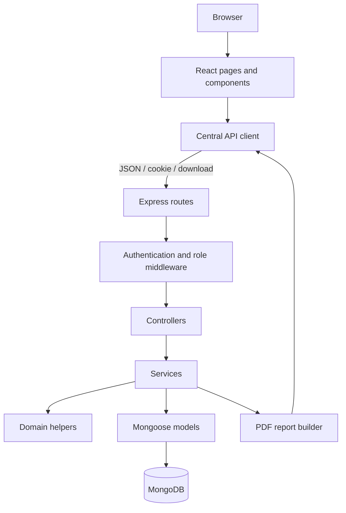

# VendorPulse

This is a source-grounded study guide for the final VendorPulse repository. It explains what the application does, how its layers connect, why its main design decisions were made, and what to say in a demonstration or viva. File paths, route permissions, score rules, and limitations below were checked against the source code rather than inferred from the project name.

## 1. Project introduction

### Simple idea

VendorPulse is a **supplier performance management system**. A procurement team can keep supplier records, define weighted performance criteria, submit one quarterly evaluation per supplier, compare suppliers that were evaluated under the same criteria, and produce management reports.

Supplier performance matters because price alone does not show whether a supplier is dependable. Poor quality can create rework, late delivery can interrupt production, and hidden logistics costs can erase an attractive unit price. VendorPulse puts these factors into one controlled, repeatable process.

### Who uses it

- An **Admin** manages users, KPIs, suppliers, evaluations, reports, and every read-only area.
- A **Procurement Manager** manages suppliers and submits evaluations, but cannot manage users or KPIs.
- A **Viewer** can inspect dashboards, supplier history, evaluation results, comparisons, and reports, but cannot change business data.

### Main capabilities

VendorPulse provides authenticated sessions, backend-enforced role permissions, supplier lifecycle management, configurable weighted KPIs, quarterly evaluations, immutable historical KPI snapshots, dashboard summaries, compatible supplier comparison, CSV data export, PDF management reports, user administration, safe database initialization, and an optional professional demo dataset.

“Level 3” in this project means the application goes beyond CRUD screens: it has role-based workflows, domain calculations, historical consistency rules, reporting, exports, transactions, security controls, and automated backend tests.

### 30-second project explanation

> VendorPulse is a MERN application for evaluating supplier performance. Admins configure weighted KPIs and users; Admins and Procurement Managers manage suppliers and submit quarterly evaluations; Viewers have read-only access. The backend calculates the authoritative weighted score, rating, and risk. Every evaluation stores KPI snapshots so history remains correct if criteria later change. The application also supports dashboards, compatible supplier comparison, CSV export, and server-generated PDF reports.

### 2-minute project explanation

> VendorPulse solves the problem of supplier decisions being spread across informal notes and spreadsheets. It provides one secure workflow for supplier records, KPI configuration, quarterly evaluation, and reporting. The current baseline KPIs are Quality at 45%, Delivery at 30%, and Cost at 25%.
>
> The frontend is React with React Router and a small authentication Context. It calls an Express API through one central fetch helper. The backend separates routes, middleware, controllers, services, domain rules, and Mongoose models. MongoDB stores users, suppliers, KPIs, and evaluations.
>
> Security is enforced twice: the frontend hides unavailable actions for usability, while Express middleware independently checks the current database user and role. Passwords are bcrypt hashes, and the eight-hour JWT is kept in an HttpOnly cookie instead of local storage.
>
> The most important design is historical integrity. An evaluation stores the KPI name and weight used when it was submitted, along with a signature of the complete criteria configuration. That prevents later KPI changes from rewriting history and prevents misleading comparisons. The backend—not React—calculates the score, rating, and risk. Reports can be downloaded as raw CSV data or a formatted PDF management report.

## 2. Complete technology stack

| Technology | What it is | Where VendorPulse uses it | Why it fits |
| --- | --- | --- | --- |
| React 19 | Component-based UI library | `client/src`, pages, forms, shared components | The UI has many interactive states but is still small enough for plain React. |
| Vite 8 | Development server and build tool | `client/package.json`, `vite.config.js` | Fast local startup, JSX handling, optimized production build, and an `/api` proxy. |
| JavaScript/JSX | Application language and React markup syntax | Both `client` and `server` | One language across the stack reduces context switching. TypeScript was not necessary for this project size. |
| React Router 7 | Client-side navigation | `client/src/App.jsx` | Supports nested layout routes, protected routes, URL parameters, and redirect state. |
| React Context | Shared authentication state | `client/src/auth/AuthContext.jsx` | Only session/user state is global; Redux would add unnecessary machinery. |
| Fetch API | Browser HTTP client | `client/src/api/client.js` | Native, sufficient for JSON and binary downloads, and requires no Axios dependency. |
| Plain CSS | Styling | `index.css`, `App.css`, page CSS files | Design tokens and page-specific styles are enough; no utility framework or large UI library is needed. |
| Lucide React | Icon component library | Layout and UI actions | Gives consistent, accessible vector icons without maintaining a custom icon set. |
| Node.js | JavaScript server runtime | Entire `server` application | Non-blocking I/O suits an API that mostly waits for MongoDB and report streams. |
| Express 5 | Web/API framework | `server/src/app.js`, routes and middleware | Small, explicit, and flexible for the repository's layered REST API. |
| Mongoose 9 | MongoDB object modelling | Schemas, queries, population, sessions | Adds validation, models, references, indexes, and transaction integration over the raw driver. |
| MongoDB Atlas | Hosted document database | Configured through `MONGODB_URI` | Evaluation documents naturally contain nested score snapshots. Atlas avoids operating a local database server in production-like use. |
| bcryptjs | Password hashing | `server/src/domain/passwords.js` | Slow salted hashing protects stored passwords; the pure-JS package is easy to install across platforms. |
| JSON Web Token | Signed session claim | `server/src/domain/auth.js` | A compact signed token identifies a session without a separate server session store. |
| HttpOnly cookie | Browser token storage | `vp_session` set in `authController.js` | Browser JavaScript cannot read it, reducing token theft through XSS compared with `localStorage`. |
| Helmet | Security headers | First middleware in `app.js` | Adds sensible HTTP response headers with one maintained package. |
| cookie-parser | Cookie parsing | `app.js`, then `requireAuth` | Makes `req.cookies.vp_session` available to authentication middleware. |
| dotenv | Local environment loading | `server.js` and scripts through `dotenv/config` | Keeps URIs, signing keys, and bootstrap credentials out of source code. |
| PDFKit | Programmatic PDF library | `server/src/reports/evaluationPdfReport.js` | Creates a branded A4 report directly from trusted server data, without a browser renderer. |
| npm | Package and script runner | Both `package.json` files | Installs dependencies and provides repeatable dev, test, build, init, and seed commands. |
| nodemon | Development process monitor | Server `npm run dev` | Restarts the backend after source edits. It is not a production dependency. |
| ESLint | Static frontend checks | Client `npm run lint` | Finds invalid hook usage and common JavaScript/JSX mistakes. |
| Git/GitHub | Version-control workflow | Repository history/process | Tracks code and supports collaboration. GitHub is not a runtime library used by the app. |

### Why MERN

MERN means MongoDB, Express, React, and Node. VendorPulse benefits from a JSON-shaped data flow: React sends JSON, Express validates it, Mongoose maps it to documents, and MongoDB stores it. Nested evaluation score snapshots are especially natural as embedded document arrays.

### Important comparisons

- **React vs server-rendered pages:** React keeps form state, filters, review drafts, and navigation responsive without full-page reloads. A server-rendered framework would also work, but would be unnecessary for this focused SPA.
- **MongoDB vs SQL:** SQL would be a valid choice and stronger for complex relational analytics. MongoDB fits the small set of collections and embedded evaluation snapshots. Uniqueness and references are still enforced where needed.
- **Mongoose vs raw MongoDB driver:** the driver would require repeating validation and document-shape logic. Mongoose centralizes schemas, casting, indexes, population, and serialization.
- **Cookie JWT vs localStorage JWT:** localStorage is readable by injected JavaScript. The HttpOnly cookie is automatically sent by the browser but cannot be read by React. SameSite also reduces some cross-site request risk.
- **Server PDF vs screenshot/print:** a browser screenshot varies with viewport and client state. PDFKit produces deterministic pages from filtered backend records, supports pagination and headers, and does not trust rendered browser content.

## 3. High-level architecture



The diagram is accurate with one nuance: domain helpers do not access MongoDB; services call them for deterministic rules such as score calculation, signatures, and password handling.

- **Frontend:** owns presentation, controlled forms, navigation, loading/error states, and helpful early validation. It does not own authoritative permissions or scores.
- **API client:** standardizes credentials, query construction, JSON errors, and file downloads.
- **Routes:** match method/path and attach middleware/controllers.
- **Middleware:** authenticates and authorizes before protected controllers run.
- **Controllers:** translate HTTP requests into service calls and send HTTP responses.
- **Services:** enforce use-case rules and coordinate queries.
- **Domain helpers:** hold reusable pure rules that can be tested without Express or MongoDB.
- **Models/database:** enforce document structure and persistence constraints.

The frontend cannot be trusted alone because users can bypass buttons and call HTTP endpoints directly. Therefore the backend rechecks roles, active status, scores, criteria, weights, and uniqueness.

## 4. Project folder structure

```text
VendorPulse/
├── README.md
├── docs/
│   ├── api.md
│   ├── data-model.md
│   ├── progress.md
│   ├── requirements.md
│   ├── test-evidence.md
│   └── VendorPulse_Complete_Study_Guide.md
├── client/
│   ├── package.json, vite.config.js, eslint.config.js
│   └── src/
│       ├── api/                 central HTTP client
│       ├── auth/                Context, hook, protected route
│       ├── components/          reusable visual components
│       ├── comparison/          compare validation/message helpers
│       ├── evaluations/         evaluation draft/validation helpers
│       ├── kpis/                KPI form/weight helpers
│       ├── suppliers/           supplier API and validation helpers
│       ├── users/               user API and validation helpers
│       ├── layout/              authenticated shell/sidebar/header
│       ├── pages/               route-level screens and page CSS
│       ├── assets/              logo and images
│       ├── App.jsx              route map
│       ├── App.css              shared application styling
│       ├── index.css            global tokens/reset
│       └── main.jsx             browser entry point
└── server/
    ├── package.json
    ├── src/
    │   ├── config/              MongoDB connection
    │   ├── controllers/         HTTP adapters
    │   ├── domain/              pure rules/constants/security helpers
    │   ├── middleware/          auth, authorization, errors
    │   ├── models/              Mongoose schemas
    │   ├── reports/             PDF presentation model/renderer
    │   ├── routes/              REST endpoint definitions
    │   ├── scripts/             explicit init and demo-seed entry points
    │   ├── services/            business use cases/data access
    │   ├── app.js               Express configuration
    │   └── server.js            environment, DB connect, listen
    └── test/                    Node test-runner suites
```

Folders are separated by responsibility. For example, `evaluationRoutes.js` does not calculate a score; it reaches `evaluationController.js`, which calls `evaluationService.js`, which uses `evaluationRules.js` and `Evaluation.js`. That makes each layer easier to reason about and test.

## 5. Backend startup flow

The runtime path is `server/src/server.js` → `connectDB()` → `app.listen(...)`.

1. `import "dotenv/config"` loads local environment values.
2. Importing `app.js` constructs an Express application.
3. `helmet()` is registered first, then `express.json({ limit: "1mb" })`, then `cookieParser()`.
4. `GET /api/health` and every route module are mounted.
5. `errorHandler` is mounted last so errors forwarded by controllers reach it.
6. `startServer()` awaits `connectDB()` from `server/src/config/db.js`.
7. Only after MongoDB connects does Express listen on `process.env.PORT || 5002`.
8. A startup failure logs a generic startup message plus the error message and exits with status 1.

```js
await connectDB();
app.listen(PORT, () => {
  console.log(`VendorPulse API running on http://localhost:${PORT}`);
});
```

**Why split `app.js` and `server.js`?** `app.js` describes HTTP behavior; `server.js` performs external startup. The Express app can be inspected or tested without automatically opening a database connection and port.

**Why middleware order matters:** JSON parsing must occur before controllers read `req.body`; cookie parsing must occur before `requireAuth` reads `req.cookies`; error handling must come after routes. The public health endpoint returns status 200 and confirms that the API process is responding, though it is not a deep database health check.

## 6. Database and Mongoose

### Core terms in this project

- A **database** is the selected MongoDB database, such as the final `vendorpulse` database.
- A **collection** is a group of related documents. Mongoose pluralizes the model names into `users`, `suppliers`, `kpis`, and `evaluations`.
- A **document** is one JSON-like stored record.
- An **ObjectId** is MongoDB's identifier type. VendorPulse validates externally supplied IDs before querying.
- A **Schema** defines fields, validators, defaults, references, indexes, timestamps, and serialization behavior.
- A **Model** such as `Evaluation` exposes operations including `find`, `create`, and `countDocuments`.
- A **reference** stores another document's ObjectId. `populate()` replaces it in query results with selected related fields.
- An **index** improves lookup or enforces a constraint. `unique` creates a database uniqueness index; it is not merely UI validation.
- A **sparse unique index** ignores documents where an optional indexed value is missing. Supplier `taxId` uses this behavior.

### User schema — `server/src/models/User.js`

| Field | Type | Rules and reason |
| --- | --- | --- |
| `name` | String | Required and trimmed; human display name. |
| `email` | String | Required, unique, lowercased, trimmed; login identifier. |
| `passwordHash` | String | Required, `select: false`; never stores the original password. |
| `role` | String enum | Required: `ADMIN`, `PROCUREMENT_MANAGER`, or `VIEWER`. |
| `status` | String enum | Required; defaults to `ACTIVE`, can be `INACTIVE`. |
| timestamps | Date | Automatic `createdAt` and `updatedAt`. |

The `toJSON` transform deletes `passwordHash`. This is a final serialization barrier even if a document internally contains the field.

### Supplier schema — `server/src/models/Supplier.js`

| Field | Type | Rules and reason |
| --- | --- | --- |
| `supplierName` | String | Required, trimmed; company display name. It is not declared unique. |
| `contactPerson` | String | Optional, trimmed. |
| `email` | String | Optional, lowercased and trimmed. |
| `phone` | String | Optional, trimmed. |
| `category` | String | Required, trimmed; used for display/filtering. |
| `address` | String | Optional, trimmed. |
| `taxId` | String | Optional, trimmed, unique and sparse. |
| `contractStart` | Date | Optional. |
| `contractEnd` | Date | Optional; validator rejects it when both dates exist and end is before start. |
| `status` | String enum | `ACTIVE` by default or `ARCHIVED`. |
| `createdBy` | ObjectId → User | Required audit ownership reference. |
| timestamps | Date | Automatic creation/update dates. |

### KPI schema — `server/src/models/KPI.js`

| Field | Type | Rules and reason |
| --- | --- | --- |
| `name` | String | Required, unique, trimmed. |
| `description` | String | Optional explanatory text. |
| `weight` | Number | Required; greater than 0 and at most 100. |
| `status` | String enum | `ACTIVE` by default or `INACTIVE`. |
| `createdBy` | ObjectId → User | Required. |
| timestamps | Date | Automatic. |

The schema validates each weight, while `validateActiveKpiWeights()` validates the **combined active total**.

### Evaluation schema — `server/src/models/Evaluation.js`

| Field | Type | Rules and reason |
| --- | --- | --- |
| `supplierId` | ObjectId → Supplier | Required. |
| `evaluatorId` | ObjectId → User | Required. |
| `year` | Number | Required integer. Source does not impose a min/max year. |
| `quarter` | Number enum | Required: 1, 2, 3, or 4. |
| `criteriaSignature` | String | Required digest of the exact KPI configuration. |
| `scores` | Embedded array | At least one score snapshot is required. |
| `scores[].kpiId` | ObjectId → KPI | Required identity of the criterion at submission. |
| `scores[].kpiNameSnapshot` | String | Required historical name. |
| `scores[].weightSnapshot` | Number | Required historical weight, greater than 0 and at most 100. |
| `scores[].score` | Number | Required integer from 1 through 5. |
| `scores[].comment` | String | Optional, maximum 500 characters. |
| `overallScore` | Number | Required, 1 through 5; backend-derived. |
| `performanceRating` | String enum | Required derived rating. |
| `riskLevel` | String enum | Required derived risk. |
| `comments` | String | Optional overall comment, maximum 2,000 characters. |
| timestamps | Date | Automatic. |

The compound unique index `{ supplierId: 1, year: 1, quarter: 1 }` prevents a second evaluation for the same supplier-period. A period/creation index supports listing by year/quarter and newest time.

## 7. User model deep dive

The password field is named `passwordHash` to make its meaning explicit. `hashPassword()` in `server/src/domain/passwords.js` uses bcryptjs with **12 rounds**. A one-way salted hash can be checked but should not be reversed.

```js
const user = await User.findOne({
  email: email.trim().toLowerCase(),
}).select("+passwordHash");
```

- `findOne` searches by normalized email.
- The schema normally excludes `passwordHash`.
- `.select("+passwordHash")` explicitly requests it only because login must call `verifyPassword()`.
- The returned API user is then constructed from public fields, and schema serialization provides another safety layer.

Roles answer **what may this active user do?** Status answers **may this account use the application at all?** `requireAuth` rejects an inactive account with 403 even if its cookie token is otherwise valid.

## 8. Supplier model and rules

An active supplier can appear in the new-evaluation configuration. Archiving changes only `status`; the application exposes no hard-delete supplier route. Existing evaluations still reference the supplier and remain readable in history, reports, and results.

Important rules:

- Name and category are required.
- Optional dates are converted and validated; contract end cannot precede contract start.
- A supplied `taxId` must be globally unique. Sparse uniqueness allows multiple suppliers with no tax ID.
- `createdBy` comes from the authenticated user, not an arbitrary browser value.
- Search escapes regular-expression characters before searching name, contact, email, and tax ID. Category and status use their own exact filters.
- List pagination defaults safely and caps page size at 100.
- Only Admin and Procurement Manager may create, edit, or archive; every role may read.
- `createEvaluation()` independently verifies that the selected supplier is active.

## 9. KPI model and business rules

The approved baseline is **Quality 45%**, **Delivery 30%**, and **Cost 25%**, all active. A weight determines how strongly its score affects the overall result.

`validateActiveKpiWeights()` in `server/src/domain/kpiRules.js` filters to active KPIs, requires at least one, sums their numeric weights, and accepts the total only when its distance from 100 is at most `0.000001`. Thus 40 + 30 + 20 = 90 is invalid. Inactive KPIs are excluded because they are not part of the next evaluation form.

`updateKpiWeights()` accepts a nonempty array of distinct valid KPI IDs. It loads all affected records, applies proposed values in memory, loads all KPIs, overlays the proposed weights, validates the resulting active total, and only then saves. This coordinated endpoint is important: changing 45 to 40 in one request would temporarily create an invalid total, while changing all related weights together can preserve 100.

The single-KPI edit path validates the individual weight but does **not** itself enforce that the complete active total remains 100. If an Admin creates, activates, deactivates, or individually edits KPIs into an invalid set, evaluation configuration reports `valid: false` and submission is blocked until weights are corrected through the coordinated workflow. This is an important source-level nuance.

## 10. Complete authentication flow

```mermaid
sequenceDiagram
    participant U as User
    participant L as LoginPage
    participant A as AuthContext/API client
    participant E as Express
    participant DB as MongoDB
    U->>L: email and password
    L->>A: login(credentials)
    A->>E: POST /api/auth/login
    E->>DB: normalized email lookup + passwordHash
    DB-->>E: user document
    E->>E: bcrypt compare; active check; sign JWT
    E-->>A: Set-Cookie vp_session; public user JSON
    A-->>L: save current user
    L-->>U: navigate to intended page/dashboard
```

`createSessionToken()` signs an **HS256** JWT using `JWT_SECRET`, with the user ID in `sub` and an **8-hour** expiry. The controller sets `vp_session` with `httpOnly: true`, `sameSite: "lax"`, a matching eight-hour max age, and `secure: true` only when `NODE_ENV === "production"`.

The API client always uses `credentials: "include"`, so the browser sends the cookie on API requests. React never receives or stores the raw JWT.

`GET /api/auth/me` runs `requireAuth` and returns current public user fields. AuthContext calls it when the app mounts to restore a browser session. `POST /api/auth/logout` clears the same cookie with matching security attributes; it is public so a stale/invalid cookie can still be cleared.

Invalid email/password gets 401 without revealing which part was wrong. An inactive matching user gets 403 and no cookie. HttpOnly prevents ordinary browser JavaScript from reading the token; SameSite Lax reduces cross-site cookie sending, while HTTPS plus Secure protects it in production transport.

## 11. Authentication middleware

`server/src/middleware/auth.js` performs these steps:

1. Read `req.cookies?.vp_session`.
2. Return 401 if absent.
3. Verify signature/expiry with `verifySessionToken()`.
4. Load `User.findById(payload.sub)` from the database.
5. Return 401 if the user no longer exists.
6. Return 403 if the account is inactive.
7. Put the current document on `req.user` and call `next()`.

The JWT deliberately identifies the user rather than being trusted as a permanent role snapshot. Role authorization reads the freshly loaded database user, so role changes and deactivation take effect on the next request without waiting eight hours.

**401** means there is no accepted identity: missing, malformed, expired, or unknown-user session. **403** means the identity is known but not allowed: inactive account or excluded role.

## 12. Role-based access control

| Capability | Admin | Procurement Manager | Viewer |
| --- | --- | --- | --- |
| Dashboard | Read | Read | Read |
| Suppliers/history | Read/create/edit/archive | Read/create/edit/archive | Read only |
| KPIs/weights | Full | No access | No access |
| Evaluations | Read/create | Read/create | Read only |
| Compare | Read | Read | Read |
| Reports/CSV/PDF | Read/export | Read/export | Read/export |
| Users | Full supported create/edit/list | No access | No access |

`ProtectedRoute` handles frontend session/role routing. `AppLayout` omits Admin-only navigation, and pages omit mutation actions when a role cannot use them. On the server, `requireAuth` runs first and `allowRoles(...)` returns 403 when `req.user.role` is not allowed.

Hiding a button improves usability, but it is not security: anyone can construct an HTTP request. The Express middleware is the authority.

## 13. Frontend startup and routing

`client/src/main.jsx` uses `createRoot`, wraps the app in React `StrictMode`, and renders `App`. `App.jsx` adds `BrowserRouter` and `AuthProvider`.

Public route: `/login`.

Authenticated routes under `ProtectedRoute` and `AppLayout`:

- `/dashboard`
- `/suppliers`, `/suppliers/:id`
- `/suppliers/new`, `/suppliers/:id/edit` — Admin/Manager
- `/evaluations`, `/evaluations/:id`
- `/evaluations/new`, `/evaluations/review` — Admin/Manager
- `/compare`, `/reports`
- `/access-denied`
- `/kpis`, `/kpis/new`, `/kpis/weights`, `/kpis/:id/edit` — Admin
- `/users`, `/users/new`, `/users/:id/edit` — Admin
- catch-all not-found page

While authentication is loading, `ProtectedRoute` shows a branded loading state. An anonymous visitor is redirected to `/login` with the intended location in router state. A signed-in user lacking a required role is redirected to `/access-denied`.

`BrowserRouter` creates clean nested URLs. Vite's development server supplies SPA history fallback, so a local refresh reaches `index.html` and React rematches the URL. A future production web server must also be configured to return `index.html` for unknown client-side paths; no deployment configuration in this repository proves that behavior outside Vite.

## 14. Authentication Context

`AuthContext.jsx` holds `user` and `status` (`loading`, `authenticated`, or `anonymous`). On mount it calls `/auth/me`; a cleanup flag prevents a completed asynchronous request from updating state after unmount.

Important operations:

- `restoreSession()` calls `/auth/me` and updates status.
- `login(credentials)` calls `/auth/login`, stores the returned public user, and marks authenticated.
- `logout()` calls `/auth/logout` and clears local user state even as the application returns to anonymous use.
- The provider memoizes the context value so consumers do not receive a new object for unrelated renders.
- `useAuth()` is the small consumer hook; `auth-context.js` holds the Context object separately.

Context is sufficient because only a small session object and three actions are shared globally. Supplier, report, and form data remain local to their pages, so Redux would add actions/reducers/store conventions without solving a present complexity.

## 15. Central API client

`client/src/api/client.js` uses relative `/api` URLs, allowing Vite to proxy during development and a same-origin deployment later. `buildQueryString` omits empty values and appends array values as repeated parameters.

The JSON helper:

1. builds URL/query parameters;
2. sets `credentials: "include"`;
3. adds JSON headers/body when appropriate;
4. parses JSON when returned;
5. throws an `ApiError` carrying HTTP status, message, code, and additional response data on failure.

`downloadApiFile()` fetches with credentials, turns the body into a `Blob`, derives a safe name from `Content-Disposition`, creates a temporary hidden anchor, clicks it, removes it, and revokes the object URL. The same path supports CSV and PDF.

Centralization prevents pages from inconsistently forgetting cookies, JSON parsing, error codes, or blob cleanup.

## 16. Dashboard

`client/src/pages/DashboardPage.jsx` builds 16 recent quarter choices, defaults to the current quarter, and calls `GET /api/dashboard?year=...&quarter=...`.

`dashboardService.js` validates the period and runs five independent operations in parallel:

- count all active suppliers;
- count evaluations in the selected period;
- count selected-period evaluations whose risk is `HIGH` or `CRITICAL`;
- aggregate counts by performance rating;
- load the five newest selected-period evaluations with supplier/evaluator display fields.

The UI displays three summary cards, a four-category **rating distribution**, and recent evaluations, with skeleton, error, and empty states. It is read-only because it summarizes already-authorized records rather than defining business data.

**Source-vs-wording correction:** the Dashboard does not return or render a full Low/Moderate/High/Critical risk distribution. It shows one combined High/Critical count. The PDF report does include a full risk distribution.

## 17. Suppliers module

The list page supports a 300 ms debounced search, category/status filters, pagination, and an Active default. Admin/Manager see Add and edit/archive actions; Viewer sees read-only information.

Typical create flow:

`SupplierFormPage.jsx` → central API call `POST /api/suppliers` → `supplierRoutes.js` → `requireAuth` → `allowRoles(Admin, Manager)` → `supplierController.js` → `createSupplier()` → `Supplier.create()` → JSON response → navigate/show success.

The frontend validates required text, email format when present, and date order for quick feedback. The service rechecks required values and dates; the Mongoose schema provides final structure/uniqueness/date validation. Frontend email format checks are stronger than the current server model, which normalizes but does not define an email-regex validator.

`SupplierDetailsPage.jsx` loads the supplier and its evaluation history. Archiving uses `ConfirmDialog`, changes status through `PATCH /api/suppliers/:id/archive`, removes it from future evaluation configuration, and preserves old evaluations.

## 18. KPI management module

Only Admin routes expose:

- KPI list: `GET /api/kpis`
- add: `POST /api/kpis`
- edit/status: `PATCH /api/kpis/:id`
- coordinated weights: `PUT /api/kpis/weights`

`KpisPage` shows status, weight, and whether the active total is valid. `KpiFormPage` handles create/edit. `KpiWeightsPage` loads active criteria, keeps an editable weight map, calculates the proposed total with `useMemo`, and submits the related changes together.

Frontend validation is guidance, not authority. The API revalidates numeric ranges, IDs, duplicates, existence, status enums, and the resulting total. Future evaluations use the changed configuration; saved evaluations keep snapshots.

## 19. Evaluation module deep dive

### Step 1: get trusted configuration

Admin/Manager opens `EvaluationFormPage`, which calls `GET /api/evaluation-config`. The response contains alphabetically sorted active suppliers and KPIs, total active weight, validity/message, and—only for a valid configuration—the criteria signature.

### Step 2: build a draft

`evaluationUtils.js` creates controlled score/comment entries. It validates supplier, period, exactly one score for every active KPI, integer values 1–5, per-KPI comment length, overall comment length, and configuration validity. It also computes a preview, but the preview is not authoritative.

### Step 3: review

The draft is passed in router state to `EvaluationReviewPage`. The page shows the supplier, period, criterion weights, comments, preview score/rating/risk, then submits the normalized payload.

### Step 4: server validation and save

`createEvaluation()` validates IDs, period, signature, comments, supplier status, current active KPIs/total, signature freshness, exact score coverage, duplicate IDs, score range, and comment length. It creates trusted snapshots from database KPI records, calculates result fields with domain helpers, and calls `Evaluation.create()`.

### Criteria signature

`generateCriteriaSignature()` in `server/src/domain/criteriaSignature.js` creates a canonical list of each KPI's ID, name, and normalized weight, sorts it by ID, serializes it, and returns a SHA-256 digest.

If a form was opened under one configuration and an Admin changes criteria before submission, the browser's signature no longer equals the newly generated signature. The API returns 409 with `CRITERIA_CHANGED`. The review page reloads configuration, reconciles the draft where possible, and sends the user back to review/edit rather than silently applying different weights.

The signature is not a password and is not used for authentication. It is a compact identity for the complete criteria version.

## 20. Evaluation score calculation

The exact formula in `server/src/domain/evaluationRules.js` is:

```text
overall = roundTo2Decimals(Σ(score × weightSnapshot) / 100)
```

With Quality 5 at 45%, Delivery 4 at 30%, and Cost 3 at 25%:

```text
(5 × 45 + 4 × 30 + 3 × 25) / 100
= (225 + 120 + 75) / 100
= 4.20
```

Every score must be a whole integer from 1 through 5. Every weight must be positive, and the snapshots must total exactly 100 within a tiny floating-point tolerance. The service requires exactly one submitted score for every active KPI, rejects duplicate or unknown KPI IDs, limits KPI comments to 500 characters, and limits overall comments to 2,000.

React may show a preview using equivalent client logic, but the server recalculates from trusted KPI snapshots and ignores any client-supplied overall/rating/risk.

## 21. Performance rating rules

The exact thresholds are centralized in `getPerformanceRating()`:

| Overall score | Stored rating |
| --- | --- |
| 4.00–5.00 | `EXCELLENT` |
| 3.00–3.99 | `GOOD` |
| 2.00–2.99 | `NEEDS_IMPROVEMENT` |
| 1.00–1.99 | `POOR` |

The checks run from the highest boundary downward. Central domain logic prevents the seed, normal evaluation service, and tests from inventing different classifications.

## 22. Risk level rules

`getRiskLevel()` uses the same numeric bands with inverse business meaning:

| Overall score | Stored risk |
| --- | --- |
| 4.00–5.00 | `LOW` |
| 3.00–3.99 | `MODERATE` |
| 2.00–2.99 | `HIGH` |
| 1.00–1.99 | `CRITICAL` |

Rating describes performance quality; risk describes procurement exposure. Both are calculated from the same authoritative score and stored with the immutable evaluation. Storage makes historical queries and distributions straightforward; calculation in one helper keeps creation and demo data consistent.

## 23. Immutable evaluation snapshots

Each score keeps `kpiId`, `kpiNameSnapshot`, and `weightSnapshot`. Suppose Q2 used Quality 45%, then an Admin changes it to 40%. A Q2 result must still show 45%, because that was the rule under which the supplier earned its score.

Keeping only a reference to the current KPI would rewrite the meaning of old results whenever a KPI changed, was renamed, or became inactive. VendorPulse therefore builds snapshot values from current database KPIs at submission and reads those saved values in result, compare, CSV/PDF analysis, and history.

There is no evaluation edit or delete endpoint. This is application-level immutability: it preserves the record that was actually submitted. MongoDB itself is not append-only, so database administrators still need normal operational controls.

## 24. Duplicate evaluation rule

One supplier may have only one evaluation for a given `supplierId + year + quarter`. The Evaluation compound unique index enforces this atomically in MongoDB. If two requests race, one may pass service checks, but the unique index still rejects the duplicate. `errorHandler.js` recognizes this evaluation key pattern and returns HTTP 409 with a controlled message.

## 25. Archived supplier evaluation rule

Archiving represents “do not use for future procurement evaluations,” not “erase history.” `createEvaluation()` loads the supplier and returns 400 if its status is not active. `getEvaluationConfig()` also excludes archived suppliers. List/detail/report queries do not erase old results, so past accountability remains intact.

## 26. Evaluation list and result

`EvaluationsPage.jsx` calls the paginated evaluation endpoint with supplier/year/quarter filters and links each row to `/evaluations/:id`. The backend caps page size at 100, validates IDs and periods, sorts newest first, and populates supplier and evaluator display data.

`EvaluationResultPage.jsx` renders the saved period, supplier, evaluator, overall score, rating, risk, snapshot KPI names/weights/scores, individual comments, and overall comments. It is intentionally read-only. All roles can list and view; only Admin and Procurement Manager see/create new evaluation actions.

## 27. Compare module

`ComparePage.jsx` loads all supplier pages for selection, accepts a year/quarter, and requires two or three distinct suppliers. It calls `GET /api/comparisons` with repeated `supplierIds` query parameters.

`compareSuppliers()` rechecks:

1. exactly 2–3 distinct, valid ObjectIds;
2. valid integer year and quarter 1–4;
3. an evaluation for every selected supplier in that period;
4. exactly one shared `criteriaSignature` across those evaluations.

Missing results return 400 with code `MISSING_EVALUATION` and missing supplier IDs. Different criteria return 409 with code `INCOMPATIBLE_CRITERIA`. Compatible output includes each supplier's overall score/rating/risk and side-by-side snapshot criterion scores.

Two totals may look similar even when derived from different KPIs or weights. Comparing their criterion rows as though identical would be misleading, so compatibility is an explicit business rule. The service returns a signature internally in JSON, although the UI and management PDF do not present it as a business label.

## 28. Reports module

`ReportsPage.jsx` offers supplier, year, and quarter filters, a paginated result table, links to evaluation results, and CSV/PDF buttons. The page defaults to the current period.

- **Dashboard** gives a concise selected-period operational overview.
- **Compare** requires 2–3 complete, criteria-compatible evaluations and aligns KPI scores.
- **Reports** lists historical records across an optional scope and exports them.

Reports are useful for audit/history and management communication. Rating and risk are displayed but are not accepted as report filters by the current backend.

## 29. CSV export

CSV is plain tabular text that spreadsheet software can filter and analyze. The flow is:

`ReportsPage` → `downloadApiFile('/reports/evaluations.csv', filters)` → report route/controller → `getEvaluationReportCsv()` → filtered populated query → CSV escaping → response with CSV content/disposition headers → browser Blob download.

The export columns are Supplier, Category, Year, Quarter, Overall Score, Performance Rating, Risk Level, Evaluator, and Submitted At. Comments and KPI-level rows are **not** part of the current CSV. Values containing commas, quotes, or line breaks are quoted, and embedded quotes are doubled. More than 10,000 matching records returns 400 and asks for narrower filters.

## 30. PDF report

The PDF flow is:

`ReportsPage` → current filters → `GET /api/reports/evaluations.pdf` → shared filter validation → `getEvaluationReportPdfData()` → populated lean evaluations (maximum 500) → presentation model in `evaluationPdfReport.js` → PDFKit buffer/stream → `application/pdf`, safe filename, `Cache-Control: no-store` → Blob download.

PDFKit was chosen because it runs on the server, lays out deterministic A4 pages, streams/buffers output without a browser, and works directly with trusted report data.

The renderer provides branded headers/footers and page numbering. Depending on scope/data, it produces:

- report scope and UTC generation metadata;
- executive summary metrics;
- complete rating and risk distributions;
- supplier performance/overall score presentation;
- KPI analysis based on saved snapshots;
- detailed evaluation sections with comments;
- a clear empty report state;
- an individual summary for a one-evaluation scope instead of a misleading comparison chart.

KPI analysis groups incompatible `criteriaSignature` sets rather than averaging different definitions together. Raw IDs and signatures are excluded from the presentation model. CSV is meant for raw analysis; PDF is meant for management reading.

## 31. User management

Admin-only user pages support search, role/status filters, pagination, create, and edit/deactivate/reactivate. There is no `GET /api/users/:id`, so `userApi.js` finds an edit target by paging/searching the list endpoint.

Create requires name, email, role, and a password of at least eight characters. `userService.js` hashes it before `User.create()`. Server-side source normalizes email but does not contain a full email-format validator; the frontend supplies format feedback. Password reset/change is not implemented.

Edit supports name, role, and status. Email is read-only in the UI and not an allowed service update. Any user whose current role is Admin cannot be demoted or deactivated through this endpoint. This protection applies to all Admin accounts, not only the initial Admin.

`passwordHash` is excluded from default queries and removed by `toJSON`, so create/list/patch responses never serialize it.

## 32. HTTP status codes in VendorPulse

| Code | Meaning here | Real example |
| --- | --- | --- |
| 200 | Successful read/update/download | session restore, dashboard, patched supplier, report |
| 201 | Resource created | supplier, KPI, evaluation, or user created |
| 400 | Invalid request/business input | invalid ObjectId, quarter, score, weight total, archived supplier |
| 401 | No accepted identity | missing/expired JWT or wrong login credentials |
| 403 | Identity known but forbidden | Viewer calls KPI route; inactive user requests API |
| 404 | Requested record missing | supplier/evaluation/KPI/user update target not found |
| 409 | State conflict | duplicate evaluation, duplicate unique value, stale criteria, incompatible comparison |
| 500 | Unexpected server failure | unrecognized exception handled without internal details in response |

## 33. Error handling

Controllers use `try/catch` and call `next(error)`. The final `errorHandler` translates known failures:

- duplicate-key errors into 409, including a specific duplicate evaluation message;
- Mongoose `ValidationError` into 400 using the first validation message;
- Mongoose `CastError` into 400;
- service errors carrying `status`, `code`, or missing IDs into controlled JSON;
- everything else into a generic 500 response.

The server may log the error for diagnosis, but the frontend does not receive a stack trace, database command, URI, or secret. There is no custom API catch-all 404 middleware in `app.js`; unmatched API routes fall through to Express's default not-found response rather than the JSON error handler unless an error is raised.

## 34. Safe database initialization

`npm run db:init` runs `server/src/scripts/initializeDatabase.js`; normal startup never imports or runs it.

The script requires a MongoDB URI with an explicit database name and private `INITIAL_ADMIN_NAME`, `INITIAL_ADMIN_EMAIL`, and `INITIAL_ADMIN_PASSWORD`. The service inspects application collections and classifies the state:

- **empty:** create exactly one active Admin and three active baseline KPIs;
- **exact initialized baseline:** return a safe no-op;
- **partial/unexpected:** abort without writing.

The approved KPIs are Quality 45, Delivery 30, and Cost 25 and must belong to the initial Admin. Recognition also checks that the Admin has a valid-looking bcrypt hash. Creation occurs in a MongoDB transaction: hash/create the Admin, then create KPI records in compatible ordered behavior, then inspect and verify the final exact state. A failure rolls back rather than leaving an Admin-only database.

The initializer never calls `dropDatabase`, collection drop, or blanket delete. Rerunning does not rotate the Admin password. Therefore **`db:init` means initialize an approved empty state; it does not mean reset a database**.

Unlike the demo seed, the initializer requires an explicit database name but is not hard-coded to the literal name `vendorpulse`. Operators must still choose the intended empty database.

## 35. Optional demo data seed

`npm run db:seed-demo` is deliberately separate from initialization. `seedDemoData.js` requires the connected database name to be exactly `vendorpulse` both before and after connection, so it rejects `test` and every unexpected name.

The service accepts only:

- the exact one-Admin, three-KPI, zero-supplier, zero-evaluation baseline; or
- the exact completed demo state, which produces `ALREADY_SEEDED` with no writes.

Any partial or altered state aborts. It preserves the Admin, reads two demo passwords only from `DEMO_MANAGER_PASSWORD` and `DEMO_VIEWER_PASSWORD`, hashes them, uses sequential/ordered transaction operations, verifies the final exact state, and uses no destructive delete.

### Demo users

- Kavya Iyer — active Procurement Manager
- Rohan Malhotra — active Viewer

### Demo suppliers

- Meridian Components — Electronic Components
- BluePeak Industries — Precision Manufacturing
- Northstar Industrial Supply — Industrial Supplies
- Crestline Technologies — Enterprise Technology
- Horizon Materials — Raw Materials

Contact data uses fictional people and reserved `example.com` email addresses.

### Exact evaluation matrix

| Supplier | Period | Quality | Delivery | Cost | Overall | Rating | Risk |
| --- | --- | ---: | ---: | ---: | ---: | --- | --- |
| Meridian Components | Q2 2026 | 4 | 4 | 4 | 4.00 | Excellent | Low |
| Northstar Industrial Supply | Q2 2026 | 4 | 3 | 3 | 3.45 | Good | Moderate |
| Crestline Technologies | Q2 2026 | 3 | 4 | 4 | 3.55 | Good | Moderate |
| Meridian Components | Q3 2026 | 5 | 4 | 4 | 4.45 | Excellent | Low |
| BluePeak Industries | Q3 2026 | 4 | 4 | 4 | 4.00 | Excellent | Low |
| Northstar Industrial Supply | Q3 2026 | 4 | 3 | 3 | 3.45 | Good | Moderate |
| Crestline Technologies | Q3 2026 | 3 | 4 | 3 | 3.30 | Good | Moderate |
| Horizon Materials | Q3 2026 | 3 | 2 | 2 | 2.45 | Needs Improvement | High |

Meridian improves, Northstar stays stable, and Crestline declines modestly. Concise professional comments are stored at both criterion and overall level. This state gives useful Dashboard, supplier history, Compare, Reports, CSV, and PDF demonstrations.

## 36. Final database states

The intended `vendorpulse` database is the final application database. The separate historical development `test` database is not an initializer/seed target and should remain untouched. Separation prevents development records from being mistaken for professional demonstration data and makes safety checks meaningful. This guide contains no connection URI or credential.

## 37. End-to-end flow 1: login

| Step | File/function | Input | Output/next step |
| --- | --- | --- | --- |
| 1 | `LoginPage.jsx` submit handler | controlled email/password | calls `login()` |
| 2 | `AuthContext.jsx` `login` | credentials | `api.post('/auth/login')` |
| 3 | `api/client.js` | JSON body, credentials included | `POST /api/auth/login` |
| 4 | `authRoutes.js` | Express request | `authController.login` |
| 5 | `authController.js` | normalized email | query including hidden hash |
| 6 | `verifyPassword` | entered password + stored hash | boolean |
| 7 | `createSessionToken` | user document | signed 8-hour JWT whose subject is the user ID |
| 8 | controller | JWT | HttpOnly cookie + public user JSON |
| 9 | AuthContext | public user | authenticated state |
| 10 | LoginPage/router | prior `from` or default | Dashboard/intended route |

## 38. End-to-end flow 2: create supplier

1. Admin/Manager opens `/suppliers/new`; role protection occurs in `App.jsx`.
2. `SupplierFormPage` controls fields and `supplierUtils.js` provides early validation.
3. API client sends `POST /api/suppliers` with JSON and the session cookie.
4. `supplierRoutes.js` authenticates, then authorizes Admin/Manager.
5. `supplierController.addSupplier` passes body plus `req.user._id` to the service.
6. `createSupplier()` trims/validates required data and dates.
7. `Supplier.create()` applies schema rules, uniqueness, defaults, creator, and timestamps.
8. The controller returns 201; the page navigates to the created supplier/details flow.

Duplicate tax IDs become 409. Invalid data becomes 400. A Viewer calling the API directly gets 403.

## 39. End-to-end flow 3: submit evaluation

1. Admin/Manager opens `/evaluations/new`.
2. `EvaluationFormPage` requests current active suppliers/KPIs and signature.
3. The page creates a controlled draft with one row per active KPI.
4. `evaluationUtils.js` checks completeness, score integers/range, and comment limits, and shows a preview.
5. The draft moves through router state to `/evaluations/review`.
6. `EvaluationReviewPage` presents the exact submission and builds the API payload.
7. `POST /api/evaluations` passes authentication and role middleware.
8. The service reloads the supplier and current active KPIs rather than trusting labels/weights from React.
9. It requires active supplier, valid 100% total, matching criteria signature, exact distinct KPI coverage, and valid comments/scores.
10. It constructs `kpiNameSnapshot` and `weightSnapshot` from database KPIs.
11. Domain helpers calculate overall, rating, and risk.
12. `Evaluation.create()` saves; the unique compound index prevents a duplicate period.
13. The API returns 201 and the UI opens the read-only result.
14. If criteria changed, the page receives `CRITERIA_CHANGED`, reloads, reconciles, and asks the user to review again.

## 40. End-to-end flow 4: compare suppliers

`ComparePage` loads supplier options, validates 2–3 distinct selections and period, then calls `/api/comparisons`. Route middleware permits all roles. The service queries matching evaluations, reports missing ones, compares signature count, constructs per-KPI maps from saved snapshots, and returns aligned scores plus overall classifications. The page renders the result or a specific missing/incompatible message.

## 41. End-to-end flow 5: generate PDF

1. User sets Reports filters and clicks Export PDF.
2. `downloadApiFile()` sends those same supplier/year/quarter filters with the cookie.
3. Report route authenticates and permits all three roles.
4. Controller calls shared filter/query service.
5. Service validates, enforces the 500-record cap, populates display data, and uses `lean()` for plain report objects.
6. PDF module derives summaries and compatible snapshot groups and renders PDFKit pages in memory.
7. Controller sets type, filename, length, and no-store headers.
8. Browser receives a Blob; a temporary link downloads it; the object URL is revoked.

## 42. End-to-end flow 6: create user

`UserFormPage` collects a temporary password only during create → `POST /api/users` → Admin-only middleware → `addUser` controller → `createUser()` validates fields/role/password length → `hashPassword()` bcrypts with 12 rounds → `User.create()` stores only the hash → `toJSON` removes the hash → 201 public response. Neither the original password nor hash is returned.

## 43. Frontend page-by-page guide

| Page/file | Route/access | State and API | Remember for viva |
| --- | --- | --- | --- |
| `LoginPage.jsx` | `/login`, public | email/password/errors; calls AuthContext login | Redirects to intended route and never stores JWT. |
| `DashboardPage.jsx` | `/dashboard`, all roles | period/loading/data/error; GET dashboard | 3 metrics, rating distribution, recent 5; no full risk chart. |
| `SuppliersPage.jsx` | `/suppliers`, all roles | search/category/status/page; GET suppliers | 300 ms debounced search; mutations hidden for Viewer. |
| `SupplierFormPage.jsx` | new/edit, Admin/Manager | form/errors/loading; POST/PATCH supplier | Same form serves modes; frontend and server validation. |
| `SupplierDetailsPage.jsx` | `/suppliers/:id`, all roles | supplier/history/dialog states; GET supplier + evaluations, archive action | Archive preserves history and blocks future evaluation. |
| `KpisPage.jsx` | `/kpis`, Admin | KPI list/active total; GET KPIs | Changes affect future evaluations only. |
| `KpiFormPage.jsx` | KPI new/edit, Admin | form/errors; POST/PATCH | Individual validity differs from coordinated total validity. |
| `KpiWeightsPage.jsx` | `/kpis/weights`, Admin | active weight map/useMemo total; PUT weights | Submit related weight changes atomically as one validated use case. |
| `EvaluationsPage.jsx` | `/evaluations`, all roles | filters/page/list; GET evaluations | All read; only Admin/Manager create. |
| `EvaluationFormPage.jsx` | `/evaluations/new`, Admin/Manager | config/draft/validation | Gets signature and passes draft to review. |
| `EvaluationReviewPage.jsx` | `/evaluations/review`, Admin/Manager | draft/submission/stale criteria | Backend result is authority; handles `CRITERIA_CHANGED`. |
| `EvaluationResultPage.jsx` | `/evaluations/:id`, all roles | saved result/loading/error; GET evaluation | Renders historical snapshots and comments read-only. |
| `ComparePage.jsx` | `/compare`, all roles | selections/period/result; GET suppliers + comparison | Exactly 2–3, same period and signature. |
| `ReportsPage.jsx` | `/reports`, all roles | filters/page/rows; report JSON/CSV/PDF | JSON paginated; downloads preserve filters. |
| `UsersPage.jsx` | `/users`, Admin | search/role/status/page; GET users | Never displays/receives password hashes. |
| `UserFormPage.jsx` | user new/edit, Admin | form/user lookup/errors; POST/PATCH | Email read-only on edit; Admin cannot be demoted/deactivated. |
| `AccessDeniedPage.jsx` | `/access-denied`, authenticated | no API | Friendly 403-style UI. |
| `NotFoundPage.jsx` | catch-all | no API | Client-side unknown route. |

All data pages include some combination of loading, controlled error, and empty state. `PlaceholderPage.jsx` remains in source but is not used by the final route map.

## 44. Shared frontend components

- `AsyncState.jsx`: consistent loading/error/empty presentation primitives.
- `Brand.jsx`: reusable logo/name treatment.
- `ConfirmDialog.jsx`: accessible confirmation surface used for consequential actions such as archive.
- `PageHeader.jsx`: consistent title, description, and action area.
- `Pagination.jsx`: shared page navigation based on backend metadata.
- `RatingBadge.jsx` and `RiskBadge.jsx`: consistent semantic labels/colors.
- `UserBadges.jsx`: formats role/status values.
- `ProtectedRoute.jsx`: session and optional role gate using `<Outlet>`.
- `AppLayout.jsx`: fixed header, responsive sidebar, navigation, user menu, and logout.

Reusable components make behavior and visual language consistent and reduce bugs caused by copying slightly different loading states, badges, or paging logic.

## 45. CSS and UI architecture

`index.css` defines global font/rendering rules and tokens for navy/blue surfaces, semantic colors, borders, shadows, radii, header height, and sidebar width. `App.css` covers shared shell, navigation, buttons, forms, cards, tables, login, and common layouts. Page CSS files group module-specific rules: Dashboard, supplier, evaluation, KPI, compare/report, and user pages.

At `max-width: 760px`, the header becomes shorter, the profile copy hides, a menu button appears, the sidebar becomes an off-canvas panel, and main padding/type scale tighten. A `prefers-reduced-motion` rule minimizes transitions and animations. Focus-visible outlines and semantic success/warning/danger badges improve usability.

Plain CSS is sufficient because VendorPulse has one cohesive custom design, a small token set, and no need for a large themed component catalog. It avoids framework-specific class markup while keeping responsive behavior explicit.

## 46. Important backend file-by-file guide

### Entry, configuration, middleware, and routes

| Path | Purpose and important exports | Called by / calls | Rules to remember |
| --- | --- | --- | --- |
| `server/src/server.js` | `startServer()` entry | npm scripts; calls `connectDB`, `app.listen` | Database must connect before listen. |
| `server/src/app.js` | configured Express `app` | imported by server; mounts middleware/routes | 1 MB JSON limit; health public; error handler last. |
| `server/src/config/db.js` | `connectDB()` | server/scripts; calls `mongoose.connect` | URI must exist. |
| `middleware/auth.js` | `requireAuth` | protected routes; JWT helper + User model | Reloads active user each request. |
| `middleware/authorize.js` | `allowRoles(...roles)` closure | route definitions | 401 if no attached user; 403 for excluded role. |
| `middleware/errorHandler.js` | global `errorHandler` | Express last middleware | Maps duplicate, validation, cast, known, and generic errors. |
| `routes/authRoutes.js` | login/me/logout routing | mounted `/api/auth`; auth controller | Only `me` requires auth. |
| `routes/supplierRoutes.js` | supplier REST routes | supplier controller | reads all; writes Admin/Manager. |
| `routes/kpiRoutes.js` | KPI REST routes | KPI controller | Admin only; `/weights` declared before `/:id`. |
| `routes/evaluationRoutes.js` | config/evaluation routes | mounted at `/api` | create/config Admin/Manager; reads all. |
| `routes/dashboardRoutes.js` | dashboard GET | dashboard controller | all three roles. |
| `routes/comparisonRoutes.js` | comparison GET | comparison controller | all three roles. |
| `routes/reportRoutes.js` | JSON/CSV/PDF routes | report controller | shared auth and all-role authorization. |
| `routes/userRoutes.js` | list/create/patch | user controller | whole router Admin-only. |

### Controllers

Every controller file in `server/src/controllers` is a thin HTTP adapter: it reads `req.params`, `req.query`, `req.body`, or `req.user`; awaits the matching service; selects a success status/header; and forwards failures with `next(error)`.

| File | Main responsibility |
| --- | --- |
| `authController.js` | login lookup/password check/cookie, public current user, cookie clearing |
| `supplierController.js` | supplier list/detail/create/update/archive HTTP responses |
| `kpiController.js` | KPI list/detail/create/update/coordinated weights |
| `evaluationController.js` | configuration, create, list, result |
| `dashboardController.js` | passes year/quarter to dashboard service |
| `comparisonController.js` | passes supplier IDs/period and returns comparison |
| `reportController.js` | JSON result, CSV headers/text, PDF buffer/headers |
| `userController.js` | list/create/update public user documents |

### Domain and models

| Path | Important exports | Why it matters |
| --- | --- | --- |
| `domain/constants.js` | role/status/rating/risk constant objects | Prevents scattered spelling variants. |
| `domain/passwords.js` | `hashPassword`, `verifyPassword`, `isPasswordHash` | Bcrypt boundary and initialization verification. |
| `domain/auth.js` | `createSessionToken`, `verifySessionToken` | HS256, secret requirement, eight-hour token. |
| `domain/kpiRules.js` | `validateActiveKpiWeights` | Active criteria must exist and total 100. |
| `domain/evaluationRules.js` | score/rating/risk functions | Authoritative result classification. |
| `domain/criteriaSignature.js` | `generateCriteriaSignature` | Stable SHA-256 identity for criterion version. |
| `models/User.js` | `User` model | private hash, role/status, `toJSON`. |
| `models/Supplier.js` | `Supplier` model | lifecycle/contact/contracts/tax uniqueness. |
| `models/KPI.js` | `KPI` model | unique criterion and numeric weight. |
| `models/Evaluation.js` | `Evaluation` model | snapshots, result, compound uniqueness. |

### Services, reports, and scripts

| Path | Important exports/callers | Important rules |
| --- | --- | --- |
| `services/supplierService.js` | list/get/create/update/archive; supplier controller | pagination, escaped search, dates, supported fields, archive not delete |
| `services/kpiService.js` | KPI CRUD/weights; KPI controller | ID/range/status validation and full active-total check for coordinated weights |
| `services/evaluationService.js` | config/create/list/get; evaluation controller | active supplier, signature, exact KPI coverage, snapshots, derived result |
| `services/dashboardService.js` | `getDashboardData`; dashboard controller | selected-period metrics, ratings, recent five |
| `services/comparisonService.js` | `compareSuppliers`; comparison controller | 2–3 distinct, complete period, compatible signature |
| `services/reportService.js` | filter/JSON/CSV/PDF data; report controller | shared filters; JSON 100/page, CSV 10,000, PDF 500 |
| `services/userService.js` | list/create/update; user controller | hash, supported roles, Admin protection, no email update |
| `reports/evaluationPdfReport.js` | presentation model, filename, PDF renderer | snapshot grouping, summaries, layouts, no raw IDs/signatures |
| `services/databaseInitializationService.js` | baseline classification/init | empty/exact only, transaction, one Admin + 3 KPIs |
| `scripts/initializeDatabase.js` | repository adapter and command entry | loads secrets privately, explicit DB name, connects/disconnects |
| `services/demoDataService.js` | definitions/classification/seed | exact baseline or exact demo only; real domain calculations |
| `scripts/seedDemoData.js` | demo repository adapter/entry | literal `vendorpulse` guard; ordered transaction writes |

## 47. Important frontend file-by-file guide

| Path/group | Purpose, important component/functions, API role |
| --- | --- |
| `main.jsx` | Creates root and renders the application in StrictMode. |
| `App.jsx` | Complete BrowserRouter route/role map. |
| `api/client.js` | `api` methods, query encoding, `ApiError`, binary download. All pages depend on this boundary. |
| `auth/AuthContext.jsx` | `AuthProvider`, restore/login/logout; uses auth endpoints. |
| `auth/ProtectedRoute.jsx` | Loading, anonymous redirect, role denial, `<Outlet>`. |
| `auth/auth-context.js`, `useAuth.js` | Context definition and safe consumer hook. |
| `layout/AppLayout.jsx` | Authenticated shell, role-aware navigation, mobile sidebar, profile/logout. |
| `components/*` | Shared async states, brand, confirmation, headers, pagination, rating/risk/user badges. |
| `pages/LoginPage.jsx` | Login controlled form and intended-route redirect. |
| `pages/DashboardPage.jsx` | Period options, dashboard fetch/render. |
| `pages/SuppliersPage.jsx` | Debounced/filterable/paginated list. |
| `pages/SupplierFormPage.jsx` | Create/edit supplier. |
| `pages/SupplierDetailsPage.jsx` | Detail, evaluation history, archive confirmation. |
| `suppliers/supplierApi.js` | Loads every supplier page when compare/report selectors need the complete set. |
| `suppliers/supplierUtils.js` | roles, defaults, form validation/payload conversion. |
| `pages/KpisPage.jsx` | Criteria overview and active total. |
| `pages/KpiFormPage.jsx` | Create/edit/status criterion. |
| `pages/KpiWeightsPage.jsx` | Coordinated active weight editor. |
| `kpis/kpiUtils.js` | form/weight validation and helpers. |
| `pages/EvaluationsPage.jsx` | Filtered history. |
| `pages/EvaluationFormPage.jsx` | trusted config + controlled draft. |
| `pages/EvaluationReviewPage.jsx` | review, submit, stale-signature recovery. |
| `pages/EvaluationResultPage.jsx` | immutable result/snapshot reader. |
| `evaluations/evaluationUtils.js` | current period, draft, preview, validation, payload, reconciliation. |
| `pages/ComparePage.jsx` | supplier/period selection and comparison table. |
| `comparison/comparisonUtils.js` | exact-count/distinct validation and domain error messages. |
| `pages/ReportsPage.jsx` | report filters/table/download actions. |
| `pages/UsersPage.jsx` | Admin list/search/role/status filters. |
| `pages/UserFormPage.jsx` | create/edit, protected Admin controls. |
| `users/userApi.js` | list and page-scanning ID lookup. |
| `users/userUtils.js` | allowed values, create/edit validation/payloads. |
| `pages/AccessDeniedPage.jsx`, `NotFoundPage.jsx` | route outcome pages. |
| `index.css`, `App.css`, `pages/*.css` | global tokens/shared system/module-specific responsive styles. |

## 48. Important functions to know

| Function/file | Input → output | Step-by-step importance |
| --- | --- | --- |
| `requireAuth` / `middleware/auth.js` | request cookie → `req.user` or error | Verify token, reload user, reject absent/inactive, attach identity. |
| `allowRoles` / `middleware/authorize.js` | allowed roles → middleware closure | Captures allowed set and checks current role for each request. |
| `calculateOverallScore` / `evaluationRules.js` | score snapshots → 2-decimal score | Validates scores/weights/100 total and calculates weighted result. |
| `getPerformanceRating`, `getRiskLevel` | score → enum | Central exact thresholds. |
| `generateCriteriaSignature` | current KPIs → SHA-256 string | Canonicalizes IDs/names/weights so configuration change is detectable. |
| `validateActiveKpiWeights` | KPI documents → `{valid,total,message}` | Excludes inactive, requires active entries, tests exact total. |
| `createEvaluation` | payload + evaluator ID → saved evaluation | Most important use case: revalidate, snapshot, calculate, persist. |
| `updateKpiWeights` | array of ID/weight → saved KPIs/total | Simulates complete post-update state before saving. |
| `compareSuppliers` | IDs + period → aligned comparison | Checks completeness/signature and maps snapshot scores. |
| `buildReportFilter` | optional filters → Mongoose filter | One validation source shared by JSON, CSV, and PDF. |
| `getEvaluationReportCsv` | filters → CSV text | count cap, populate, escape, serialize. |
| PDF model/renderer functions | report data/scope → buffer | Separate data meaning from page drawing. |
| `createUser` | public input → User document | validation, bcrypt, active creation. |
| `classify...State`/initialization | inspected collections → state name | Makes safe idempotence explicit rather than “insert if missing.” |
| `seedDemoData` | repository + env-derived credentials → status/counts | transaction, exact-state guard, ordered creates, final verification. |
| `request` / `api/client.js` | method/path/body/query → parsed data | One cookie/error/JSON policy for frontend. |
| `downloadApiFile` | path/filters → browser download | Handles binary response and cleanup. |
| `AuthProvider` operations | browser session/actions → shared user status | Restores and distributes session state. |
| evaluation utility functions | config/draft → validation/preview/payload | Guide the user but never replace backend authority. |

### Code-walkthrough examples

```js
const user = await User.findOne({ email }).select("+passwordHash");
```

`User.findOne` searches MongoDB; `{ email }` is the predicate; the `+` explicitly includes a schema-hidden field for password comparison. It does not make the hash public automatically.

```js
app.use("/api/suppliers", supplierRoutes);
```

This prefixes every path declared in `supplierRoutes`. A router path of `/` becomes `/api/suppliers`; `/:id/archive` becomes `/api/suppliers/:id/archive`.

```js
return Number((weightedTotal / 100).toFixed(2));
```

This divides weighted points by the required 100% total, rounds through a two-decimal string, then converts back to Number.

```js
const signatures = new Set(
  evaluations.map((evaluation) => evaluation.criteriaSignature)
);
```

`map` extracts each signature; `Set` removes duplicates. Size 1 means every selected evaluation used one compatible configuration.

```js
const response = await fetch(url, { ...options, credentials: "include" });
```

The browser sends the HttpOnly session cookie even though JavaScript cannot read its value.

## 49. How to walk through code in a review

Use four questions for any important line:

1. **What layer am I in?** Page, client helper, route, middleware, controller, service, domain, model, or database.
2. **What input is trusted?** Route identity and database-loaded data are stronger than browser-calculated values.
3. **What rule is enforced here?** For example, role, active supplier, 100% weights, uniqueness, or signature.
4. **What is the next call?** Trace forward and know where errors go.

Avoid explaining punctuation. Explain boundaries and decisions: why a hidden hash is selected only during login, why weights are loaded again, why snapshots are stored, or why a Set proves compatibility.

## 50. JavaScript concepts used in VendorPulse

- **async/await:** controllers await services; services await Mongoose. It reads like ordered code while remaining non-blocking.
- **Promise:** Mongoose queries and `fetch` return promises. Independent dashboard/report operations use `Promise.all` for speed; transaction creation is intentionally sequential where required.
- **try/catch:** controllers forward errors to Express; startup/scripts catch fatal errors and close/exit safely.
- **destructuring:** `const { supplierId, year, quarter } = data` names relevant payload fields.
- **spread:** `{ ...periodFilter, riskLevel: ... }` extends a MongoDB filter; form code copies state without mutation.
- **map:** transforms evaluations into CSV rows or React elements.
- **filter:** selects active KPIs or removes blank supplier IDs.
- **reduce:** totals values in UI/report calculations where used; a loop is used in the authoritative domain formula.
- **Set:** detects duplicate supplier/KPI IDs and distinct signatures.
- **Map:** efficiently joins KPIs/evaluations by ID/name.
- **optional chaining:** `req.cookies?.vp_session` safely handles missing cookies.
- **modules:** named/default imports keep files focused.
- **middleware callbacks:** `(req, res, next)` either respond or continue.
- **closures:** `allowRoles(...roles)` returns middleware that remembers allowed roles.
- **hooks:** pages use `useState`, `useEffect`, and where helpful `useMemo`; AuthContext exposes shared state.
- **controlled forms:** input `value` comes from React state and `onChange` updates it, so validation/review can use one draft.

## 51. Express concepts in this project

- `app` is the whole API configured in `app.js`.
- A `router` groups related relative paths.
- `req.params.id` reads `/suppliers/:id`; `req.query` reads filters; `req.body` reads parsed JSON; `req.cookies` reads parsed cookies.
- `res.status(201).json(...)` sends a created response. Report controllers can instead send CSV or a PDF buffer.
- `next(error)` delegates to the global error middleware.
- `router.use(requireAuth)` protects every later route in that router.
- Middleware order creates a pipeline: parse → authenticate → authorize → controller → error handling.

## 52. React concepts in this project

- A **component** is a function returning JSX, such as `RatingBadge` or a page.
- **Props** pass data/configuration down, such as pagination metadata.
- **State** stores changing local data such as filters, form fields, and loading flags.
- `useEffect` performs fetches when period/filter/page dependencies change.
- `useMemo` derives stable values such as a context object or weight total.
- **Conditional rendering** selects spinner, error, empty, or data UI.
- Lists render with stable IDs as React `key`s.
- Context avoids passing the current user through every layout/page.
- React Router maps URL state to pages and supplies params/navigation/location state.
- Protected routes are user-experience gates; backend middleware remains security.

## 53. Mongoose concepts in this project

- `new mongoose.Schema(...)` defines fields and behavior; `mongoose.model(...)` creates a collection API.
- `find` returns multiple documents, `findOne` matches one predicate, and `findById` uses `_id`.
- `create` validates and inserts. `save` validates changes on a loaded document.
- `populate('supplierId', 'supplierName status')` replaces a stored ID in the result with selected Supplier fields.
- `lean()` returns plain objects for PDF processing, avoiding document overhead/methods.
- Model validators catch field-level errors; service validation supplies clearer business rules earlier.
- Indexes enforce unique emails, KPI names, optional tax IDs, and supplier-period evaluations.
- A session/transaction groups initialization or demo writes so they commit or roll back together.

## 54. Transactions

Transactions are used by the database initializer and demo seed, not ordinary single-document CRUD. A repository adapter starts a Mongoose session and transaction, passes session-aware operations to the service, commits only after exact-state verification, aborts on error, and ends the session.

**Atomic** means observers receive all intended related records or none. This matters when one Admin plus three KPIs—or two users plus five suppliers plus eight evaluations—form one approved state.

Mongoose warns against parallel operations such as `Promise.all` inside one transaction because running operations concurrently on the same session is unsupported/undefined. The implementations therefore await dependent creates in order, and multi-document `create` calls use compatible ordered behavior where applicable. A failure throws, causing rollback.

## 55. Security design

| Control | What it reduces | Important boundary |
| --- | --- | --- |
| Bcryptjs, 12 rounds | damage if password storage is exposed | Password strength policy is only minimum length; no reset/MFA. |
| HS256 JWT with expiry | session forgery and endless sessions | Secret must remain strong/private; logout does not create a token revocation list. |
| HttpOnly, SameSite cookie; Secure in production | JavaScript token theft, some CSRF/transport risk | No explicit CSRF token is implemented. SameSite and same-origin design are partial protection. |
| Fresh User lookup | stale role/status authorization | Adds a DB query per authenticated request. |
| `allowRoles` | manual endpoint access by wrong role | Must be present on every protected route. |
| Backend validation | tampered forms/calculations | Some format checks, such as email syntax, are presently frontend-only. |
| Helmet | unsafe/missing browser headers | Does not replace input validation. |
| 1 MB JSON limit | very large JSON request abuse | File upload is not part of the app. |
| `select: false` + `toJSON` | accidental password-hash disclosure | Login explicitly selects it internally. |
| Environment variables and `.gitignore` | secrets committed in source | Operators must still manage deployment secrets safely. |
| Generic 500 response | stack/database information leakage | Server logs still need protected access. |
| Immutable snapshots and archive | history corruption | Direct database administrators remain powerful. |
| Exact init/seed guards and transactions | wrong/partial database writes | Operators must point to the correct database; demo seed adds literal-name protection. |

The source does not implement rate limiting, MFA, a CSRF token, password reset, account lockout, or a formal audit-event collection. These are limitations, not hidden features.

## 56. Testing

The server uses Node's built-in test runner (`node --test`). The current six files contain **34 declared tests**:

- `authController.test.js` (3): valid login cookie/public shape, invalid/inactive rejection, and matching logout cookie attributes.
- `comparisonService.test.js` (2): incompatible criteria rejection and supplier count/distinct validation.
- `databaseInitialization.test.js` (6): exact empty initialization, idempotence, unexpected-state abort, duplicate/invalid-hash rejection, rollback, and bootstrap configuration/database-name requirements.
- `demoDataSeed.test.js` (12): database guard, env credentials, Admin preservation/exact output, trusted snapshots/classifications, schema validity, progression, idempotence, partial-state abort, rollback, professional naming, no destructive/credential logging, and exact matrix.
- `reportPdf.test.js` (8): shared filters, summaries/compatible averages, incompatible grouping/no internals, snapshot history, valid empty/multi buffers, long content, route roles/auth, and safe filenames.
- `userSerialization.test.js` (3): `toJSON`, representative response shapes, and default hash exclusion.

Most service/domain tests use fakes/stubs and are unit or integration-style tests around several local layers, without connecting to Atlas. PDF buffer tests exercise a real renderer. They are not a full browser end-to-end suite.

The client has no automated component/browser test suite in `client/package.json`. `npm run lint` provides static correctness checks and Hook-rule enforcement; `npm run build` proves the production bundle can be compiled and catches unresolved imports/syntax. Both are useful but are not substitutes for interaction tests.

## 57. Important business rules master list

| Rule | Why | Enforced in | Violation behavior |
| --- | --- | --- | --- |
| Active authenticated user required | Protect business data | `requireAuth` | 401 missing/invalid; 403 inactive |
| Endpoint role must be allowed | Least privilege | route `allowRoles` | 403 |
| Passwords stored only as hashes | Protect credentials | password domain/user/init/seed services | original password never persisted/returned |
| Admin cannot be demoted/deactivated | Avoid removing administrative control | `userService.updateUser` | 400 |
| Email is immutable through edit | Stable login identity | service allowlist/UI | ignored/not offered |
| Active KPI set exists and totals 100% | Meaningful weighted average | KPI rule, config/create evaluation | invalid config/400 |
| Scores are whole 1–5 | Consistent scale | service, schema, domain | 400 |
| Exactly one score per active KPI | Complete, unambiguous result | evaluation service | 400 |
| Criteria signature must be current | Prevent stale-form submissions | evaluation service | 409 `CRITERIA_CHANGED` |
| Backend derives score/rating/risk | Browser cannot forge result | evaluation service/domain | client values unused |
| KPI name/weight snapshots are saved | Historical truth | evaluation service/model | historical output stays unchanged |
| One supplier-period evaluation | No double counting | unique compound index | 409 |
| Archived suppliers receive no new evaluation | Lifecycle integrity | config + create service | omitted/400 |
| Evaluations have no edit/delete route | Preserve submitted record | route design | operation unavailable |
| Compare exactly 2–3 distinct suppliers | Readable intended comparison | client + service | 400 |
| Every compared supplier needs that period | Avoid invented data | comparison service | 400 `MISSING_EVALUATION` |
| Compared criteria must match | Fair KPI comparison | signature Set | 409 `INCOMPATIBLE_CRITERIA` |
| Reports filter only supplier/year/quarter | Consistent supported scope | report service/UI | unsupported filters absent |
| CSV ≤10,000; PDF ≤500 | Bound memory/output work | report service | 400, narrow filters |
| Initialization accepts empty or exact baseline | Avoid destructive surprises | initialization service | abort/no writes |
| Demo seed accepts exact baseline/demo and exact DB name | Protect test/other data | script + demo service | abort/no writes |
| Init/seed writes are transactional/ordered | No partial approved state | repository adapters/services | rollback |

## 58. API reference for study

All protected endpoints send/receive the HttpOnly cookie. Success bodies are JSON except CSV/PDF.

### Auth and overview

| Method/path | Access | Main input → success | Common errors |
| --- | --- | --- | --- |
| `GET /api/health` | Public | none → status/message | ordinary server failure |
| `POST /api/auth/login` | Public | email/password → public user + cookie | 400 missing, 401 bad credentials, 403 inactive |
| `GET /api/auth/me` | Active user | cookie → public user | 401/403 |
| `POST /api/auth/logout` | Public | none → message + cleared cookie | unexpected 500 |
| `GET /api/dashboard` | All roles | year, quarter → metrics/ratings/recent | 400 period, 401/403 |

### Suppliers and KPIs

| Method/path | Access | Main input → success | Common errors |
| --- | --- | --- | --- |
| `GET /api/suppliers` | All roles | page, limit, search, category, status → list/pagination | 400 status, 401/403 |
| `GET /api/suppliers/:id` | All roles | ID → supplier | 400/404 |
| `POST /api/suppliers` | Admin/Manager | supplier body → created supplier | 400/409/403 |
| `PATCH /api/suppliers/:id` | Admin/Manager | supported fields → updated supplier | 400/404/409/403 |
| `PATCH /api/suppliers/:id/archive` | Admin/Manager | ID → archived supplier | 400/404/403 |
| `GET /api/kpis` | Admin | optional status → KPI list | 400/403 |
| `GET /api/kpis/:id` | Admin | ID → KPI | 400/404/403 |
| `POST /api/kpis` | Admin | name/description/weight/status → KPI | 400/409/403 |
| `PATCH /api/kpis/:id` | Admin | supported fields → KPI | 400/404/409/403 |
| `PUT /api/kpis/weights` | Admin | `updates[]` → KPIs/active total | 400 total/IDs, 404, 403 |

### Evaluations, compare, reports, users

| Method/path | Access | Main input → success | Common errors |
| --- | --- | --- | --- |
| `GET /api/evaluation-config` | Admin/Manager | none → active suppliers/KPIs/total/signature | 401/403 |
| `POST /api/evaluations` | Admin/Manager | supplier/period/signature/scores/comments → created evaluation | 400, 404, 409 duplicate/stale |
| `GET /api/evaluations` | All roles | filters/page → evaluations/pagination | 400 IDs/period |
| `GET /api/evaluations/:id` | All roles | ID → populated result | 400/404 |
| `GET /api/comparisons` | All roles | 2–3 supplierIds, year, quarter → comparison | 400 missing/invalid, 409 incompatible |
| `GET /api/reports/evaluations` | All roles | scope/page → rows/pagination | 400 filters |
| `GET /api/reports/evaluations.csv` | All roles | scope → CSV attachment | 400 filters/>10k |
| `GET /api/reports/evaluations.pdf` | All roles | scope → PDF attachment | 400 filters/>500 |
| `GET /api/users` | Admin | page/search/role/status → users/pagination | 400 filter/403 |
| `POST /api/users` | Admin | name/email/password/role → created public user | 400/409/403 |
| `PATCH /api/users/:id` | Admin | name/role/status → updated public user | 400 protected Admin, 404/403 |

## 59. Why VendorPulse was built this way

| Choice | Reason | Alternative and why it was not needed here |
| --- | --- | --- |
| MERN | One language and natural JSON/document flow | A split Java/.NET backend is valid but adds language/tooling for no present requirement. |
| React SPA | Rich filters/forms/review without full reloads | Server-rendered templates would work but make local interaction/state less direct. |
| Context | Only session state is global | Redux is better for large cross-cutting state graphs; this app does not have one. |
| Routes/controllers/services/domain | Separates HTTP, orchestration, and pure rules | Putting everything in route handlers would be quicker initially but harder to test/explain. |
| MongoDB/Mongoose | Embedded score snapshots and flexible reports fit documents | SQL is a reasonable alternative, but more joins/migrations are not required by this scope. |
| Archive | Retains supplier history | Hard delete risks broken context and audit loss. |
| Snapshot + signature | Preserves historical meaning and detects criteria versions | Reading only current KPI references silently rewrites history. |
| Server score calculation | Establishes one trusted authority | React-only calculation can be tampered with and duplicated inconsistently. |
| HttpOnly JWT cookie | Keeps token out of JavaScript and avoids server session store | localStorage is easier to inspect but more exposed to XSS token theft. |
| CSV and PDF | Separate analysis and presentation purposes | One format cannot serve both spreadsheet work and a polished management document well. |
| Server-side PDFKit | Deterministic trusted layout/data | Browser print depends on viewport/client rendering and is harder to test. |
| Separate init and seed | Clean production baseline is not demo content | Automatic seed/startup could pollute real databases. |
| Backend RBAC | API is the true security boundary | Hidden links alone can be bypassed. |
| Transactions | Related approved records form one state | Independent inserts can leave partial setup. |
| Immutable evaluations | Submitted quarterly record should remain historically accountable | Editing in place erases what was originally assessed; a future correction workflow could append a revision instead. |

## 60. Current limitations and realistic improvements

These are limitations visible in the final source, not implemented features:

- No deployment/IaC configuration; README documents local use. Add environment-specific deployment, HTTPS, SPA fallback, monitoring, and backups.
- No frontend automated test framework or browser E2E suite. Add component and Playwright/Cypress coverage.
- No password reset/change, email verification, MFA, rate limiting, or account lockout. Add these for a public production system.
- No explicit CSRF token. SameSite Lax and same-origin requests help, but a production threat model may justify token/origin checks.
- No audit-event collection showing who changed a supplier/KPI/user and the before/after values. Timestamps and `createdBy` are only partial audit data.
- No evaluation correction/version workflow; submitted results are simply immutable.
- No supplier attachments, contracts upload, notifications, or workflow approvals.
- No rating/risk report filters and no full risk chart on Dashboard.
- CSV is one row per evaluation and omits KPI/overall comments; PDF has richer details.
- User edit has no direct get-by-ID API; the client scans list pages.
- Server-side email syntax validation is not explicit for user/supplier models; client validation can be bypassed.
- No custom JSON API 404 handler.
- Search uses regex queries and may need dedicated indexing/search at large scale.
- Dashboard “evaluated supplier count” counts evaluation documents; uniqueness makes that equal to supplier count for a period.
- JWT logout clears the browser cookie but does not revoke a stolen token centrally before expiry.

## 61. How to run the project

Requirements are a supported Node.js installation and a MongoDB database.

```bash
cd server
npm install
# Copy .env.example to .env and fill private values locally.
npm run dev

cd ../client
npm install
npm run dev
```

The API defaults to port **5002**. Vite defaults to **5173** and proxies relative `/api` requests to the backend. Check `GET http://localhost:5002/api/health` for the public process health response.

Required server configuration names are `PORT`, `NODE_ENV`, `MONGODB_URI`, `JWT_SECRET`, initial Admin variables, and demo-password variables. Never put real values into documentation or Git.

Explicit one-time commands:

```bash
cd server
npm run db:init       # only approved empty/exact baseline
npm run db:seed-demo  # only reviewed exact vendorpulse baseline/demo state
```

Verification:

```bash
cd server && npm test
cd ../client && npm run lint && npm run build
```

Normal `npm start`/`npm run dev` never initializes or seeds data.

## 62. Practical debugging guide

| Symptom | Likely cause | Inspect and reason |
| --- | --- | --- |
| Frontend cannot reach API | Backend stopped, wrong proxy/port, request path not `/api` | Vite config, terminal, `/api/health`, Network panel, `api/client.js` |
| MongoDB connection fails | missing/invalid URI, network allowlist, credentials, DNS | `config/db.js`, startup message, private environment; never print URI |
| 401 after login | cookie not set/sent, expiry, signing secret mismatch, user removed | response `Set-Cookie`, browser cookie policy, `credentials: include`, auth middleware |
| 403 | inactive user or role not permitted | current user's DB status/role and route `allowRoles` |
| KPI total invalid | active weights do not total 100 or no active KPI | KPI page total, `kpiRules.js`, coordinated weights endpoint |
| `CRITERIA_CHANGED` | KPI configuration changed after form load | reload config; review reconciled draft; compare signature generation path |
| duplicate evaluation | same supplier/year/quarter exists | Evaluation unique index and evaluation list/history |
| Compare says missing | selected supplier has no evaluation in that exact period | filter evaluation history by supplier/period |
| Compare says incompatible | saved signatures differ | inspect historical snapshot definitions, not current KPI names alone |
| PDF fails | invalid scope, >500 matches, server renderer error, expired session | Network status/JSON error, report service/controller, protected server log |
| Empty Dashboard | chosen period has no evaluations; this can be correct | period selector, evaluation list, dashboard query |
| Wrong database selected | private URI names another database | stop before init/seed; inspect configured database name without exposing URI |
| Nested route refresh 404 in deployment | host lacks SPA fallback | configure host to serve client `index.html` for application routes |

Debug from the boundary inward: reproduce the request in the browser Network panel, identify status/body, locate its route, then middleware, controller, service, and model. Do not “fix” a 403 by removing authorization.

## 63. Presentation guide

1. **Problem:** “Procurement needs consistent supplier decisions across quality, delivery, and cost.”
2. **Objective:** “VendorPulse centralizes records, quarterly evaluations, comparison, and reporting.”
3. **Roles:** show the role matrix and emphasize backend enforcement.
4. **Architecture:** show React → API → middleware → service/domain → Mongoose → MongoDB.
5. **Dashboard:** explain selected-period metrics, ratings, high/critical count, and recent results.
6. **Suppliers:** explain active/archive lifecycle and preserved history.
7. **KPIs:** show 45/30/25 and why active total must be 100.
8. **Evaluation:** spend the most time here—trusted config, 1–5 scores, server formula, signature, snapshots, immutability.
9. **Compare:** show 2–3 Q3 suppliers and compatibility validation.
10. **Reports:** contrast searchable history, CSV analysis, and management PDF.
11. **Security:** explain bcrypt, HttpOnly JWT, fresh user lookup, RBAC, sanitized hashes, Helmet.
12. **Database safety:** explain explicit, idempotent transaction-based init and seed.
13. **Testing:** mention 34 backend tests plus frontend lint/build, and honestly state the frontend test limitation.
14. **Conclusion:** “The core value is not just CRUD; it is reliable, historically correct procurement evidence.”

## 64. Live demo script with current data

This sequence requires no database modification:

1. Sign in as the existing Admin without displaying credentials.
2. Select **Q3 2026** on Dashboard. Point out 5 active suppliers, 5 evaluated, 1 high/critical, rating distribution 2 Excellent/2 Good/1 Needs Improvement, and recent results.
3. Open Suppliers and show realistic categories/statuses.
4. Open Meridian Components: show Q2 4.00 and Q3 4.45 improvement.
5. Open Northstar history: show stable 3.45. Open Crestline: show modest 3.55 → 3.30 decline.
6. Open KPI Management: show Quality 45, Delivery 30, Cost 25 and total 100. Explain future-only changes; do not edit during the demo.
7. Open Horizon Materials Q3 result: show 3/2/2, 2.45, Needs Improvement, High, and professional comments.
8. Compare Meridian, BluePeak, and Northstar for Q3 2026. All use the same baseline signature and are compatible.
9. Open Reports for Q3 2026. Explain filters and result links.
10. Export CSV and explain raw columns; export PDF and show executive summary, distributions, KPI analysis, and details.
11. Open Users: show one Admin, Kavya as Manager, Rohan as Viewer; do not reveal any credential/hash.
12. Explain Viewer read-only and Manager operational permissions from the UI, then emphasize backend checks.
13. Finish with snapshots/signature: “If KPIs change later, these Q2/Q3 facts remain historically correct.”

## 65. Viva question bank

### Beginner

**1. What is VendorPulse?**  
**Short answer:** A MERN supplier performance system.  
**Detailed answer:** It manages supplier records, weighted KPI criteria, quarterly evaluations, comparisons, reports, exports, users, and permissions. The backend calculates results and preserves historical KPI snapshots.

**2. What is MERN?**  
**Short answer:** MongoDB, Express, React, and Node.js.  
**Detailed answer:** React renders the browser UI; Express on Node exposes the API; Mongoose maps JavaScript objects to MongoDB documents.

**3. Why use React?**  
**Short answer:** It suits interactive forms, filters, and reusable pages.  
**Detailed answer:** VendorPulse keeps draft scores, report filters, session state, and async states in the browser without full-page reloads.

**4. Why MongoDB?**  
**Short answer:** Its document structure fits nested evaluation snapshots.  
**Detailed answer:** Each evaluation contains an array of KPI score/name/weight snapshots. MongoDB stores this shape naturally, while indexes and references still protect important relationships.

**5. What is Express middleware?**  
**Short answer:** A function in the request pipeline.  
**Detailed answer:** VendorPulse uses middleware to add headers, parse JSON/cookies, authenticate, authorize roles, and handle errors before/after controllers.

**6. What are the three roles?**  
**Short answer:** Admin, Procurement Manager, and Viewer.  
**Detailed answer:** Admin also manages KPIs/users; Manager changes suppliers and submits evaluations; Viewer is read-only. All can use dashboard, comparison, and reports.

**7. Why bcrypt?**  
**Short answer:** To store a slow one-way password hash, not a password.  
**Detailed answer:** `bcryptjs` with 12 rounds salts and hashes passwords. Login compares the submitted value against the hash; API JSON never contains the hash.

**8. What is a JWT here?**  
**Short answer:** A signed eight-hour session token containing the user ID as subject.  
**Detailed answer:** The server signs it with HS256 and `JWT_SECRET`; verification detects tampering and expiry. It is stored in the HttpOnly `vp_session` cookie.

**9. What is an HttpOnly cookie?**  
**Short answer:** A browser cookie that normal JavaScript cannot read.  
**Detailed answer:** The browser sends it automatically with credentialed requests, reducing JWT theft through injected client JavaScript compared with localStorage.

**10. What are the four collections?**  
**Short answer:** Users, suppliers, KPIs, and evaluations.  
**Detailed answer:** Users authenticate, suppliers represent vendors, KPIs define current criteria, and evaluations store submitted quarterly results and snapshots.

### Intermediate

**11. How is the overall score calculated?**  
**Short answer:** Sum score × snapshot weight, divide by 100, round to two decimals.  
**Detailed answer:** With 5×45, 4×30, and 3×25, the score is 4.20. Scores must be whole 1–5 and weights must total 100.

**12. What are the rating thresholds?**  
**Short answer:** ≥4 Excellent, ≥3 Good, ≥2 Needs Improvement, otherwise Poor.  
**Detailed answer:** The score must be within 1–5. Central domain functions apply the boundaries consistently.

**13. What are the risk thresholds?**  
**Short answer:** ≥4 Low, ≥3 Moderate, ≥2 High, otherwise Critical.  
**Detailed answer:** Risk inversely expresses business exposure for the same authoritative score.

**14. Why must active KPI weights total 100?**  
**Short answer:** So the weighted average represents the full decision.  
**Detailed answer:** Anything else under/over-counts the evaluation. Inactive criteria do not appear in future forms, so their weights do not contribute.

**15. What is a criteria signature?**  
**Short answer:** A SHA-256 identity for KPI IDs, names, and weights.  
**Detailed answer:** The canonical configuration is sorted and hashed. A form submits its signature; the backend recomputes current configuration and rejects stale forms.

**16. Why store KPI snapshots?**  
**Short answer:** To preserve the criteria actually used historically.  
**Detailed answer:** A later rename, weight change, or deactivation cannot alter old evaluation meaning because the saved name/weight are read instead of current KPI values.

**17. How are duplicate evaluations prevented?**  
**Short answer:** A compound unique MongoDB index.  
**Detailed answer:** `{supplierId, year, quarter}` is unique. This remains safe even under concurrent requests; the error middleware maps collision to 409.

**18. Why can an archived supplier not be evaluated?**  
**Short answer:** Archived means ineligible for future assessment.  
**Detailed answer:** Configuration excludes it and submission independently rejects it, while old evaluations remain readable for history.

**19. What is 401 vs 403?**  
**Short answer:** 401 means identity not accepted; 403 means known but not allowed.  
**Detailed answer:** Missing/expired cookie is 401. Inactive account or Viewer calling an Admin endpoint is 403.

**20. Why is frontend role hiding not enough?**  
**Short answer:** HTTP calls can bypass the UI.  
**Detailed answer:** Express reloads the user and checks allowed roles, so a crafted request still fails.

**21. How does `/api/auth/me` help?**  
**Short answer:** It restores session state after refresh.  
**Detailed answer:** AuthContext cannot read the HttpOnly token, so it asks the server to verify the cookie and return public current-user data.

**22. Why Context instead of Redux?**  
**Short answer:** Only small authentication state is global.  
**Detailed answer:** Page data is local; Context exposes user/status/login/logout without store actions/reducers or another dependency.

**23. How do CSV and PDF differ?**  
**Short answer:** CSV is raw tabular analysis; PDF is management presentation.  
**Detailed answer:** CSV exports nine evaluation columns up to 10,000 rows. PDF handles up to 500 evaluations and adds summaries, distributions, KPI groups, and comments.

**24. How does comparison stay fair?**  
**Short answer:** It requires the same period and criteria signature.  
**Detailed answer:** Every selected supplier must have an evaluation, and the Set of signatures must contain exactly one value before KPI rows are aligned.

### Advanced

**25. Why reload the user on every request if the JWT is signed?**  
**Short answer:** To apply current role/status.  
**Detailed answer:** A signed token proves the server issued its subject, but embedded authorization can become stale. Database lookup makes deactivation/role changes immediate.

**26. Why both service validation and Mongoose validation?**  
**Short answer:** Clear business errors plus persistence safety.  
**Detailed answer:** Services understand cross-document/current-state rules; schemas enforce document shape even if another service path writes.

**27. Why is the signature hashed instead of storing only a version number?**  
**Short answer:** It derives directly from content without maintaining another counter.  
**Detailed answer:** Any ID/name/weight change produces a different digest. A version field could work but would require every mutation path to update it correctly.

**28. Why use transactions only for init/seed?**  
**Short answer:** Those commands create multi-document all-or-nothing states.  
**Detailed answer:** Normal creates are single-document atomic. Initialization/demo data spans related collections, so partial success would violate the approved state.

**29. Why avoid `Promise.all` in a Mongoose transaction?**  
**Short answer:** Parallel operations on one transaction session are unsupported.  
**Detailed answer:** Ordered awaits give the session a defined sequence and allow one thrown error to abort cleanly.

**30. What does `lean()` do in PDF data loading?**  
**Short answer:** Returns plain objects rather than Mongoose documents.  
**Detailed answer:** Report rendering only reads data, so document methods/change tracking are unnecessary overhead.

**31. Can an overall score be trusted because React displayed it?**  
**Short answer:** No.  
**Detailed answer:** React preview is UX only. The service rebuilds snapshots and calculates all derived fields from database criteria.

**32. Is `unique: true` a validator?**  
**Short answer:** It primarily declares a database unique index.  
**Detailed answer:** Collisions surface as duplicate-key errors; the global handler converts them to controlled 409 responses.

**33. Why does PDF group by criteria signature?**  
**Short answer:** To avoid averaging unlike KPI definitions.  
**Detailed answer:** Historical reports may span configuration changes. Grouping preserves meaningful KPI analysis without exposing the raw digest.

**34. What safety difference exists between `db:init` and `db:seed-demo`?**  
**Short answer:** Both are exact-state transactional commands; demo seed additionally requires literal database name `vendorpulse`.  
**Detailed answer:** Init builds one Admin/three KPIs from an empty DB. Seed accepts that exact baseline, preserves Admin, and adds exact demo records. Neither is a reset.

**35. What security work would you add before public internet scale?**  
**Short answer:** Rate limits, CSRF strategy, stronger account lifecycle/MFA, audit logs, monitoring, hardened deployment.  
**Detailed answer:** Existing controls are good for the project scope, but authentication abuse, revocation, origin controls, operational observability, and recovery need fuller production design.

## 66. Code viva questions

**What does this do?**

```js
router.use(requireAuth);
```

Every route declared later on that router must first establish an active current user. It avoids repeating the middleware on each line.

**Why is this safe against a stale role?**

```js
const user = await User.findById(payload.sub);
req.user = user;
```

The JWT supplies only an identity. The route uses the latest database document for role/status.

**What does this index enforce?**

```js
evaluationSchema.index(
  { supplierId: 1, year: 1, quarter: 1 },
  { unique: true }
);
```

MongoDB refuses a second document with the same supplier and quarter/year combination.

**Why use a tiny tolerance?**

```js
Math.abs(weightTotal - 100) > 0.000001
```

Floating-point arithmetic can create microscopic representation error. The rule is conceptually exactly 100%, while tolerating only negligible machine noise.

**What is protected here?**

```js
if (criteriaSignature !== currentSignature) {
  error.code = "CRITERIA_CHANGED";
  throw error;
}
```

It prevents a draft opened under old criteria from being saved under a new configuration.

**Why use `Map` here?**

```js
const activeKpiMap = new Map(
  activeKpis.map((kpi) => [kpi._id.toString(), kpi])
);
```

Each submitted score can be checked/looked up by ID efficiently, and trusted name/weight values come from the map rather than browser fields.

**What does this React pattern mean?**

```jsx
<ProtectedRoute roles={[USER_ROLES.ADMIN]} />
```

The nested UI route requires an authenticated Admin. It improves routing UX but does not replace backend Admin middleware.

**Why is this important?**

```js
credentials: "include"
```

It tells fetch to include the session cookie. The token remains inaccessible to React.

**Why revoke this URL?**

```js
URL.revokeObjectURL(objectUrl);
```

The temporary blob URL used for CSV/PDF download consumes browser resources; revoking it prevents a leak after download starts.

**What does populate do?**

```js
.populate("supplierId", "supplierName status category")
```

It resolves the stored Supplier ObjectId into selected display fields for this query result, without embedding a full supplier copy in the Evaluation.

**Why is `toJSON` still useful with `select: false`?**

`select: false` protects ordinary queries; login and seed/init code sometimes explicitly include the hash. `toJSON` is a second boundary that removes it during serialization.

## 67. Trick questions and common confusions

**If Viewer cannot see KPI Management, can they call its API?** No. Server role middleware returns 403.

**If weights change, do old overall scores recalculate?** No. Submitted documents keep snapshot weights and stored results.

**Why is the hash in MongoDB but not JSON?** Authentication needs a verifier; clients never do. Default query exclusion and `toJSON` separate those uses.

**Why not calculate only in React?** A user can alter browser code/request bodies. The server is authoritative.

**What happens on a second Q3 evaluation?** The compound unique index rejects it and the API returns 409.

**Does deactivating a KPI delete it from old evaluations?** No. Old score snapshots remain embedded.

**What if the JWT were issued before an account became inactive?** The JWT can verify, but `requireAuth` reloads the user and returns 403.

**Does logout destroy every copy of the JWT?** It clears the browser cookie. There is no server revocation list; expiry is eight hours.

**Does Dashboard have full risk distribution?** No. It has a combined high/critical count. PDF has full risk categories.

**Does CSV contain comments?** No. The current CSV has nine summary columns; PDF includes detailed comments.

**Can different historical criteria be compared?** Not in Compare. The API returns `INCOMPATIBLE_CRITERIA`; PDF separates analysis groups.

**Can the Admin edit a user's email?** No. The current service edit allowlist excludes it and the UI shows it read-only.

**Can an Admin deactivate another Admin?** No. Source protects any existing Admin from demotion/deactivation.

**Does `db:init` empty a database?** Never. Unexpected data causes abort.

**Why not seed on startup?** Startup would risk changing a real database merely by running the server. Both operations require explicit commands.

**Does `db:init` itself force the name `vendorpulse`?** No. It requires an explicit name. The demo seed is the command with the exact literal-name guard.

**Are frontend validation and Mongoose validation identical?** No. They overlap, but services handle business rules and some client format checks are stronger than schema checks.

## 68. VendorPulse quick revision

### One-page core

- **Purpose:** consistent supplier performance evaluation and reporting.
- **Stack:** React/Vite/Router/Context/CSS; Node/Express/Mongoose/MongoDB; bcryptjs/JWT/HttpOnly cookie/Helmet; CSV/PDFKit.
- **Architecture:** page → API client → route → auth/role middleware → controller → service/domain → model → MongoDB.
- **Roles:** Admin everything supported; Manager supplier/evaluation writes; Viewer read-only.
- **Collections:** users, suppliers, kpis, evaluations.
- **Baseline:** Quality 45, Delivery 30, Cost 25; active total must be 100.
- **Formula:** `Σ(score × snapshot weight) / 100`, two decimals; scores are whole 1–5.
- **Rating:** ≥4 Excellent; ≥3 Good; ≥2 Needs Improvement; else Poor.
- **Risk:** ≥4 Low; ≥3 Moderate; ≥2 High; else Critical.
- **Signature:** SHA-256 identity of sorted KPI ID/name/weight configuration; rejects stale form and validates comparison compatibility.
- **Snapshots:** old evaluation keeps KPI name/weight even after current KPI changes.
- **Uniqueness:** one evaluation per supplier/year/quarter.
- **Archive:** stops future evaluation, preserves history.
- **Authentication:** eight-hour HS256 JWT in HttpOnly `vp_session`; every request reloads active User.
- **Reports:** JSON history, raw CSV up to 10,000, management PDF up to 500.
- **Safety:** init/seed are explicit, exact-state, idempotent, transactional, non-destructive.

### Most important API memory list

`/api/auth/login`, `/api/auth/me`, `/api/dashboard`, `/api/suppliers`, `/api/kpis`, `/api/evaluation-config`, `/api/evaluations`, `/api/comparisons`, `/api/reports/evaluations[.csv|.pdf]`, `/api/users`.

### 15 likely viva prompts

1. What problem does VendorPulse solve? — Consistent supplier decisions and history.
2. Why MERN? — One JSON/JavaScript stack that fits documents.
3. Why HttpOnly? — Keep JWT out of JavaScript.
4. Why reload user? — Current role/status.
5. Why active total 100? — Valid weighted average.
6. Formula? — Sum score×weight / 100.
7. Rating/risk boundaries? — 4/3/2 descending.
8. Why snapshots? — History cannot be rewritten by current KPIs.
9. What is signature? — Criteria configuration digest.
10. Duplicate prevention? — Compound unique index.
11. Archived behavior? — No future evaluation; retain past.
12. Compare compatibility? — Same period and signature.
13. CSV vs PDF? — Analysis vs presentation.
14. Why transactions? — All-or-nothing multi-document setup.
15. Why frontend security is insufficient? — Direct API calls bypass UI.

## 69. Memory map

```text
VendorPulse
├── Identity
│   ├── User → role + status
│   └── bcrypt → JWT → HttpOnly cookie → fresh User lookup
├── Suppliers
│   └── Active → evaluate; Archived → history only
├── Criteria
│   └── Active KPIs total 100 → criteriaSignature
├── Evaluations
│   ├── supplier + quarter uniqueness
│   ├── whole scores 1–5
│   ├── name/weight snapshots
│   └── weighted score → rating + risk
├── Read models
│   ├── Dashboard → selected-period overview
│   ├── Compare → 2–3 compatible evaluations
│   └── Reports → JSON / CSV / PDF
└── Controlled setup
    ├── db:init → Admin + baseline KPIs
    └── db:seed-demo → exact professional demo state
```

The connection is: identity grants an operation; active suppliers and criteria make an evaluation possible; an immutable evaluation becomes the source for every dashboard, comparison, history, and report view.

## 70. Source traceability: important files to remember

### Frontend

- `client/src/main.jsx` — browser entry.
- `client/src/App.jsx` — definitive URL and frontend role map.
- `client/src/api/client.js` — every JSON/download request policy.
- `client/src/auth/AuthContext.jsx` — current session lifecycle.
- `client/src/auth/ProtectedRoute.jsx` — route UX protection.
- `client/src/layout/AppLayout.jsx` — role-aware application shell.
- `client/src/pages/DashboardPage.jsx` — actual dashboard features.
- `client/src/pages/EvaluationFormPage.jsx` — config/draft start.
- `client/src/pages/EvaluationReviewPage.jsx` — submit/stale recovery.
- `client/src/evaluations/evaluationUtils.js` — draft, preview, validation, reconciliation.
- `client/src/pages/ComparePage.jsx` — comparison workflow.
- `client/src/pages/ReportsPage.jsx` — JSON/export workflow.
- `client/src/index.css`, `client/src/App.css`, `client/src/pages/*.css` — tokens/shared/page responsive design.

### Backend/API

- `server/src/server.js` — connect then listen.
- `server/src/app.js` — middleware and route mounting order.
- `server/src/routes/*.js` — definitive endpoints and backend roles.
- `server/src/controllers/*.js` — HTTP/service boundary.
- `server/src/middleware/auth.js` — cookie/token/current-user enforcement.
- `server/src/middleware/authorize.js` — RBAC closure.
- `server/src/middleware/errorHandler.js` — controlled error contract.

### Database and business logic

- `server/src/models/User.js` — private hash serialization.
- `server/src/models/Supplier.js` — supplier fields/lifecycle.
- `server/src/models/KPI.js` — criteria schema.
- `server/src/models/Evaluation.js` — snapshots and unique period.
- `server/src/domain/evaluationRules.js` — exact formula/thresholds.
- `server/src/domain/kpiRules.js` — exact 100% rule.
- `server/src/domain/criteriaSignature.js` — configuration digest.
- `server/src/services/evaluationService.js` — central evaluation use case.
- `server/src/services/comparisonService.js` — compatibility rules.
- `server/src/services/dashboardService.js` — actual overview metrics.
- `server/src/services/reportService.js` — filters and export limits.
- `server/src/services/userService.js` — hashing/admin protection.

### Reporting, setup, and tests

- `server/src/reports/evaluationPdfReport.js` — PDF presentation model and drawing.
- `server/src/services/databaseInitializationService.js` — baseline classification and transaction use case.
- `server/src/scripts/initializeDatabase.js` — explicit init command adapter.
- `server/src/services/demoDataService.js` — exact demo definitions and state verification.
- `server/src/scripts/seedDemoData.js` — exact-name seed command adapter.
- `server/test/*.test.js` — 34 source-grounded regression checks.
- `README.md`, `docs/api.md`, `docs/data-model.md` — concise operator/API/model references; source remains authoritative.

## 71. Final quality check and source discrepancies

This guide was checked against the final route files, models, controllers, services, domain helpers, middleware, report renderer, React route/page/helper sources, CSS, package scripts, initialization/demo code, and test declarations.

Verified facts:

- exact endpoint prefixes and role permissions;
- 45/30/25 baseline and 100% active-total rule;
- weighted score rounding and 4/3/2 rating/risk thresholds;
- criteria canonicalization/signing behavior;
- snapshot fields and unique supplier-period index;
- HttpOnly cookie attributes and eight-hour HS256 token;
- CSV columns/10,000 cap and PDF 500 cap;
- exact init/demo accepted states and transaction intent;
- six server test files and 34 declared tests;
- frontend route/page map and 760 px responsive breakpoint.

Notable discrepancies or nuances to state honestly:

1. Some broad documentation wording says Dashboard returns “distributions,” but current source has a rating distribution and one combined high/critical risk metric—not a complete risk distribution. PDF has the complete risk distribution.
2. Existing progress documentation records historical implementation/testing phases and should not be treated as the current architecture authority.
3. The source has no frontend automated test script, deployment configuration, full API JSON 404 handler, or current production URL.
4. Normal startup does not initialize data. `db:init` requires an explicit database name but does not enforce the literal `vendorpulse` name; `db:seed-demo` does enforce it.
5. Coordinated weight update guarantees the resulting active total, while individual KPI create/edit/status changes can temporarily make configuration invalid; evaluation configuration/submission then refuses to proceed.
6. Some email-format checks are client-side rather than Mongoose/service validators.

When answering a reviewer, prefer: “The current source does X; a future enhancement could do Y.” That is more credible than claiming an absent feature.

---

### Final study advice

Do not memorize every component. Memorize four stories:

1. **Identity story:** cookie → JWT → current active User → role.
2. **Evaluation story:** active supplier + valid 100% criteria → signature → scores → trusted snapshots → server result.
3. **History story:** archive and snapshot instead of delete/recalculate.
4. **Read story:** saved evaluations power dashboard, comparison, CSV, and PDF under different rules.

If you can trace those stories through their files and explain why the backend is authoritative, you understand VendorPulse rather than merely remembering its screens.
